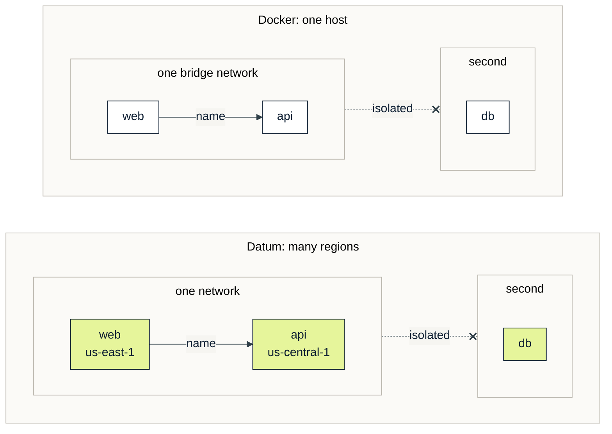

# Same(-ish) IPv6 networks

Mermaid version of [04-networks.png](04-networks.png).

*Names resolve inside a network, and networks stay isolated. Datum's networks span regions. IPv4-only services are reachable by name, through DNS64 and NAT64.*
