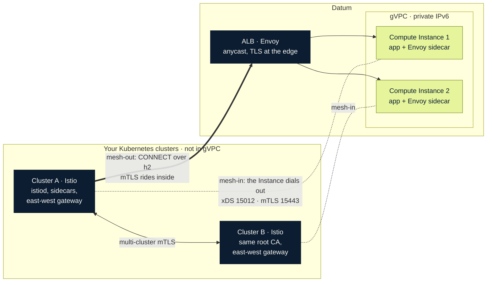
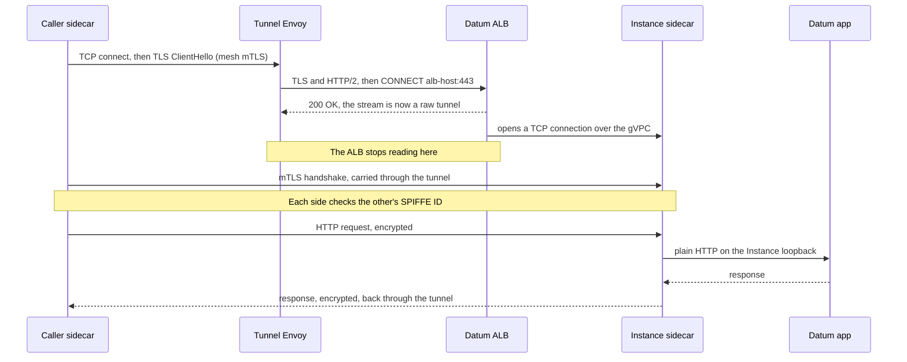
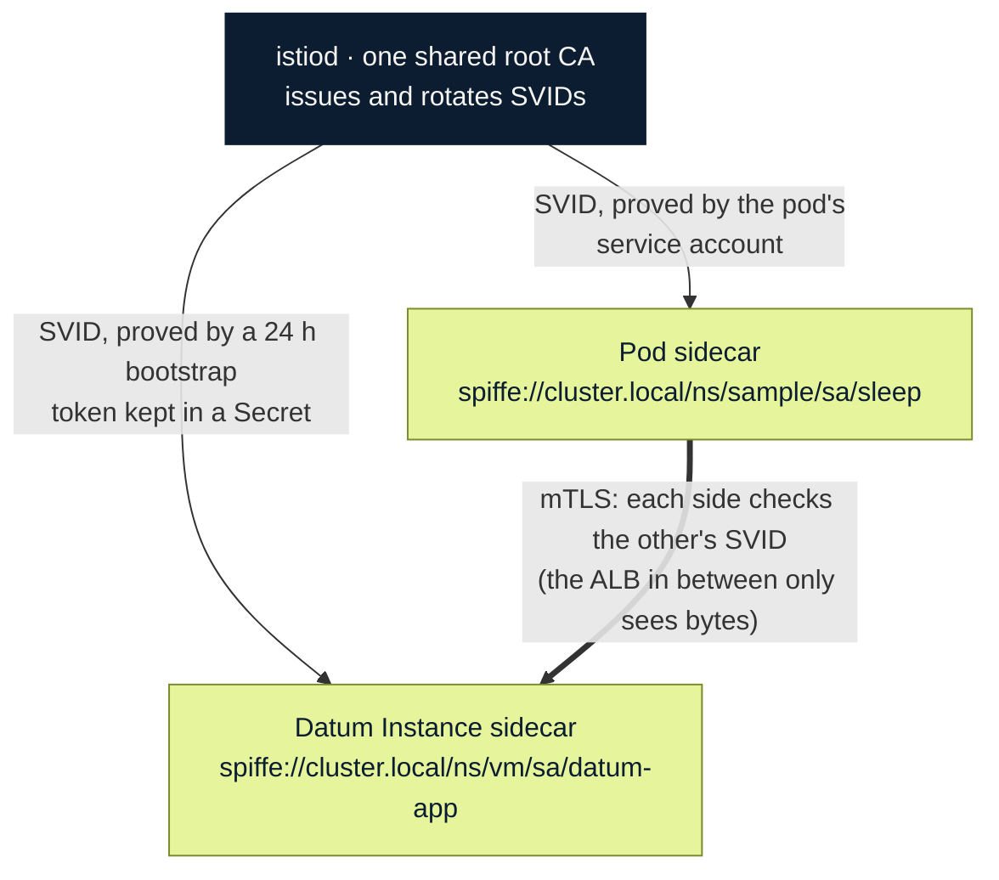
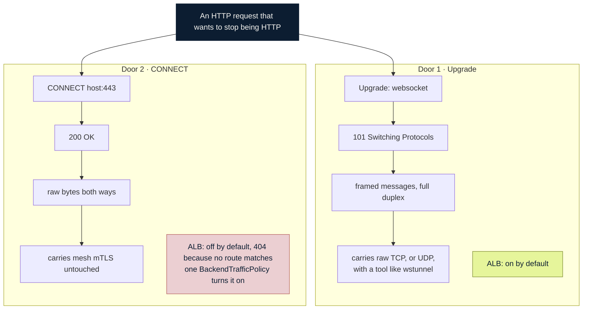

# Technical reference: bridging Istio meshes into gVPC with Datum ALB and Compute

Companion to the post [Bridge your Istio service meshes into your gVPC with Datum ALB and Compute](../../shorts/istio-datum-compute.md). It is the
runbook, the fact sheet and the troubleshooting guide behind that post, written from a real build on Nov 3 to 5, 2026.

**How to read the labels.** **[tested]** means we ran it and have output. **[docs]** means it comes from Datum's or Istio's
documentation and we did not exercise it. **[subagent]** means an assistant ran it and we did not repeat it. **[untested]**
means it is a suggestion. This file is self-contained: every manifest and script is in [Appendix A](#appendix-a-manifests-and-scripts) and the raw
output is in [Appendix B](#appendix-b-captured-output). Hostnames, project IDs and public addresses are replaced with placeholders
(`your-alb-host.datumproxy.net`, `2001:db8:...`); gVPC addresses (`fd20:...`) are private.

Contents: [1 Architecture](#1-architecture) · [2 Platform facts that shape the design](#2-platform-facts-that-shape-the-design) ·
[3 Build the clusters](#3-build-the-clusters-google-cloud) · [4 Direction 1: Datum joins the mesh](#4-direction-1-a-datum-instance-joins-the-mesh) ·
[5 Direction 2: the mesh calls Datum](#5-direction-2-the-mesh-calls-a-datum-instance-through-the-alb) ·
[6 Other paths](#6-other-paths-we-tried-or-found) · [7 IPv4 mesh variant](#7-if-your-mesh-is-ipv4) ·
[8 Measurements](#8-measurements) · [9 Troubleshooting](#9-troubleshooting-matrix) · [10 Observability recipes](#10-observability-recipes) ·
[11 Security notes](#11-security-notes) · [12 Limits and open questions](#12-limits-and-open-questions) ·
[13 Operations and cleanup](#13-operations-and-cleanup) · [14 Reference material](#14-reference-material) · [Appendix A](#appendix-a-manifests-and-scripts) · [Appendix B](#appendix-b-captured-output)

---

## 1. Architecture



*Istio clusters, the Datum ALB and gVPC: the Instance dials into the mesh, and the mesh calls back through the ALB*

Two directions, two mechanisms, one shared identity (a SPIFFE ID issued by the mesh's istiod):

| | Direction 1: **mesh-in** | Direction 2: **mesh-out** |
|---|---|---|
| Who dials | The Datum Instance dials the cluster's east-west gateway | A cluster Envoy dials the ALB |
| Transport | Outbound TCP from the Instance to gateway ports 15012 (xDS and CA) and 15443 (mTLS data, SNI passthrough) | `CONNECT` over HTTP/2 inside TLS to `your-alb-host:443`, then ALB to Instance over plain TCP on the gVPC |
| Who terminates TLS | Nobody in between: Instance Envoy and cluster Envoy | Nobody in between: caller's sidecar and Instance's sidecar. The ALB ends only its own outer TLS |
| Datum feature used | Outbound networking from Compute | ALB, `BackendTrafficPolicy`, Compute's `NetworkService` backend set |
| Mesh feature used | VM support: `WorkloadGroup`, auto-registered `WorkloadEntry` | `WorkloadEntry` plus `Service` pointing at a tunnel |
| Needs public address on the mesh side | **Yes**: the east-west gateway (an Instance can only dial public addresses) | No |
| Status | [tested] | [tested] |

**One request, hop by hop** (mesh-out, as in the cold-open diagram): caller app → (plain HTTP, localhost) caller sidecar →
(mTLS, SPIFFE identity inside) tunnel Envoy → (`CONNECT`, h2, TLS) ALB → (opaque bytes, gVPC) Instance sidecar → (mTLS ends,
identity checked, policy applied) Instance app.



*The CONNECT handshake, then mutual TLS through it*

### Ports

| Port | Where | Purpose |
|---|---|---|
| 15012/tcp | east-west gateway (and istiod) | xDS and certificate signing for VM workloads (mTLS, JWT bootstrap) |
| 15017/tcp | east-west gateway | istiod webhook, opened with the sample `expose-istiod` config |
| 15443/tcp | east-west gateway | mTLS between networks, routed by SNI (`AUTO_PASSTHROUGH`) |
| 15021/tcp | gateway and every proxy | health (`/healthz/ready`) |
| 6443/tcp | k3s API server | remote secrets between clusters (peer-only firewall rule) |
| 15000 | Envoy admin | `[::1]` on the Instance: `stats`, `certs`, `clusters`, `config_dump` |
| 15001 / 15006 | Envoy virtual outbound / inbound | present but unused here (no iptables redirect) |
| 15020 / 15090 | agent / Envoy metrics | Prometheus scrape |
| 15053 | agent DNS proxy | `[::1]:15053`; not used (no capture) |
| 8080/tcp | Instance sidecar | mesh-facing inbound listener for the app (the tunnel's target) |
| 9000/tcp | `[::1]` on the Instance | the stand-in app |

---

## 2. Platform facts that shape the design

### Datum (Compute, gVPC, ALB)

| Fact | Source |
|---|---|
| Instance = one VM with its own kernel, **one container**, **1 vCPU and 2 GiB** (`datumcloud/d1-standard-2` is the only type), no persistent disk, no health probes (ready = containers running), no scale-to-zero | [Compute limits](https://www.datum.net/docs/compute/limitations-and-roadmap) [docs] |
| Locations: `us-central-1` (Dallas), `us-east-1` (Ashburn), `us-west-1` (San Jose). Rollouts replace Instances one at a time, no surge | docs [docs] |
| Instances are **IPv6-only**: one ULA, no IPv4 address and no IPv4 route (`ip -4 route` printed 0 lines). Per network a `/48`, per location a `/64`, per Instance a `/96`. MTU 1440 | [gVPC limits](https://www.datum.net/docs/galactic-vpc/limits-and-quotas) [docs], confirmed [tested] ([capture 13](#b13-instance-net)) |
| Egress to the internet works natively over IPv6 (reached ipv6.google.com, registry.k8s.io, pkg.dev, Docker Hub); IPv4-only hosts work **by name** through DNS64 (Google `2001:4860:4860::6464`, `::64`, Cloudflare `2606:4700:4700::64`) and NAT64 (`64:ff9b::/96`). An IPv4 **literal** is "network is unreachable" | [tested] |
| Networks are isolated from each other; an Instance cannot route for other addresses (no gateway or VPN appliance without an overlay); no firewall rules yet (`networkPolicy` has no effect) | [gVPC traffic](https://www.datum.net/docs/galactic-vpc/networks/traffic) [docs] |
| Containers may be granted Linux capabilities (`securityContext.capabilities.add`, e.g. `NET_ADMIN`, `NET_RAW`) | [docs], used in round 1 [tested] |
| ConfigMaps and Secrets can be mounted as files (`volumes` plus `volumeAttachments`). Limits: 256 KiB each, 1 MiB per workload per location. **Running Instances do not notice changes**; restart the workload | [Configure a workload](https://www.datum.net/docs/compute/configuration) [docs] |
| `datumctl compute exec` gives a shell (3 open sessions per Instance, 15 min default TTL) | [Instance shell](https://www.datum.net/docs/compute/instance-shell) [docs], used throughout [tested] |
| ALB: Envoy-based, anycast, terminates TLS (ACME certificates), WAF (Coraza), auth (basic, Google OIDC, Auth0). HTTP/1.1, h2, gRPC (`--http2`, h2c to origin), WebSockets. **ALB to Instance is plain HTTP.** No raw TCP/UDP exposure. Request and idle timeouts for streaming are not documented | [ALB overview](https://www.datum.net/docs/alb/overview), [limitations](https://www.datum.net/docs/alb/limitations-and-roadmap) [docs] |
| `ClientTrafficPolicy` is **not available** in projects (so no client-certificate requirement or listener tweaks) | ALB limitations [docs] |
| An ALB is created by `datumctl compute deploy ... --http-port`; a Workload manifest cannot declare one. A flag-based deploy resets the template (drops custom `command`), so the order is: flag deploy first, then apply the manifest | [Compute and ALB](https://www.datum.net/docs/compute/compute-and-alb) [docs], [tested] |
| The `HTTPProxy` status lists three hostnames: the canonical one plus `v4.<name>` and `v6.<name>` variants to pin a family | [tested] ([capture 15](#b15-connect-policy)) |
| Resource kinds the project can create include `HTTPProxy`, `Gateway`, `HTTPRoute`, `BackendTrafficPolicy`, `SecurityPolicy`, `Backend`, `BackendTLSPolicy`, `HTTPRouteFilter`, `NetworkLoadBalancer`, `NetworkLoadBalancerRoute` | `datumctl api-resources` [tested] |
| Private DNS: documented as under active development. The control plane has `DNSResolverContext` (suffix `datum.internal`), per-region resolver addresses (`fd70:200::...`) and `Network.spec.dns.mode: Managed\|Disabled`. **Not usable from an Instance in our project**: `resolv.conf` unchanged, no `Instance.status.dns`, queries to the resolver address timed out | [Compute private DNS](https://www.datum.net/docs/compute/private-dns) [docs] vs [tested] |
| Connectors: Iroh QUIC tunnels today (first use is Datum Desktop); `datumctl connect serve` / `dial` forward TCP and UDP between enrolled devices, `up --credentials-file` for unattended use. Tailscale, WireGuard and Direct Connect are planned | [Connectors](https://www.datum.net/docs/connectors/overview) [docs]; **not exercised** |

### Istio

| Fact | Source |
|---|---|
| Multi-network mesh: pods on different networks reach each other through an east-west gateway on 15443; endpoints in a remote network are replaced by that network's gateway addresses | [Deployment models](https://istio.io/latest/docs/ops/deployment/deployment-models/) [docs], [tested] |
| VM support: `WorkloadGroup` is the template, `WorkloadEntry` is one instance; with auto-registration istiod creates the `WorkloadEntry` when the proxy connects. VMs need IP connectivity to the ingress/east-west gateway, and **all pod-to-VM traffic across networks goes through a gateway** | [VM architecture](https://istio.io/latest/docs/ops/deployment/vm-architecture/), [VM install](https://istio.io/latest/docs/setup/install/virtual-machine/) [docs] |
| Auto-registration (`PILOT_ENABLE_WORKLOAD_ENTRY_AUTOREGISTRATION`) and health checks are labelled **Alpha** in Istio's docs | VM install [docs] |
| Ambient multicluster is **beta**, multi-network only, "primary-remote not supported", and mixing it with sidecars in an existing production deployment is not recommended | [Ambient multicluster](https://istio.io/latest/docs/ambient/install/multicluster/) [docs]. **This build used sidecars; ambient is untested** |
| `Sidecar` resources can declare explicit listeners with `captureMode: NONE`, so no iptables redirect is needed | [tested] |
| `istioctl install -f` **prunes** a separately installed east-west gateway; reinstall it after any mesh reinstall | [tested] |
| For an IPv6-only proxy, istiod drops endpoints whose address family the proxy can't use **before** it substitutes gateway addresses for other-network endpoints. Result: empty EDS, `no healthy upstream`, on a proxy that shows `SYNCED` | [tested] (`debug/edsz` returned one empty locality) |
| In IPv6 mode Istio binds inbound-forwarding source addresses to an IPv6 loopback, so an app on `127.0.0.1` returns `503 ... remote connection failure`; use `[::1]` | [tested] |

### Google Cloud (the test bed)

| Fact | Source |
|---|---|
| `IPV6_ONLY` subnets and VMs exist in `us-east4` and `us-west2`; external IPv6 is a routable `/96` per VM taken from a `/64` per subnet; no NAT | [tested] |
| Cloud NAT64 (`routers nats create --nat64-all-v6-subnet-ip-ranges`) plus a DNS64 policy (`dns policies create --enable-dns64-all-queries`) make IPv4-only hosts reachable from IPv6-only VMs | [tested] |
| The VM resolver `169.254.169.254` is IPv4, so **IPv6-only pods cannot use it**. The ULA metadata resolver `fd20:ce::254` did not answer from our VMs. Use an IPv6 resolver (Google Public DNS) as the kubelet `resolv-conf` | [tested] |
| GCE firewalls default-deny inbound; IPv6 rules need `--source-ranges=::/0` (or a prefix) | [tested] |
| Which of the hosts we needed have AAAA records: **yes**: docker.io, registry-1.docker.io, quay.io, registry.k8s.io, gcr.io, `*.pkg.dev`, get.k3s.io, storage.googleapis.com. **No**: ghcr.io, github.com, objects.githubusercontent.com, istio.io, charts.istio.io | DNS lookups, Nov 3 [tested] |

---

## 3. Build the clusters (Google Cloud)

Two single-node k3s clusters, Istio 1.31.3, multi-primary on separate networks, one shared root CA. Everything is labelled
`purpose=istio-v6-lab` and named `istio-v6-*`; pass `--project` explicitly (no default project was set, and `gcloud config set`
is global state). Scripts: [`gcp-env.sh`](#a8-gcp-envsh), [`gcp-startup.sh`](#a9-gcp-startupsh),
[`gcp-startup-b.sh`](#a10-gcp-startup-bsh), [`mesh-up.sh`](#a7-mesh-upsh), [`gcp-down.sh`](#a11-gcp-downsh).

### Two phases, same result

| | Phase A | Phase B |
|---|---|---|
| VM NIC | dual-stack (`IPV4_IPV6`), IPv4 only for the operator's SSH and bootstrap | **`IPV6_ONLY`**, no IPv4 at all |
| k3s and Istio | IPv6 single-stack | IPv6 single-stack |
| Bootstrap downloads | direct (IPv4 on the NIC) | DNS64 plus Cloud NAT64 (`github.com`, `istio.io`, `ghcr.io` are IPv4-only) |
| Reaching the VMs | SSH over the NIC's IPv4 | through a small **dual-stack bastion** (the workstation had no IPv6) |
| Result | Datum Instance joins with zero workarounds | identical |

Phase A was deleted once Phase B reproduced it; both worked.

### Network, subnets, firewall

```sh
. scripts/gcp-env.sh            # sets CLOUDSDK_CORE_PROJECT, $G (gcloud), $KEY (ssh key)
$G compute networks create istio-v6 --subnet-mode=custom --enable-ula-internal-ipv6 --bgp-routing-mode=global

# dual-stack subnets (phase A) and IPv6-only subnets (phase B), one pair per region
$G compute networks subnets create istio-v6-a-east --network=istio-v6 --region=us-east4 \
    --range=10.60.1.0/24 --stack-type=IPV4_IPV6 --ipv6-access-type=EXTERNAL
$G compute networks subnets create istio-v6-b-east --network=istio-v6 --region=us-east4 \
    --stack-type=IPV6_ONLY --ipv6-access-type=EXTERNAL
# ...and the same for us-west2 (range 10.60.2.0/24)

$G compute firewall-rules create istio-v6-mesh6 --network=istio-v6 --direction=INGRESS \
    --allow=tcp:15012,tcp:15017,tcp:15443 --source-ranges=::/0            # gateway: anyone, incl. a Datum Instance
$G compute firewall-rules create istio-v6-api6  --network=istio-v6 --direction=INGRESS \
    --allow=tcp:6443 --source-ranges=<four subnet /64s>                   # API: peer clusters only
$G compute firewall-rules create istio-v6-ssh4  --network=istio-v6 --direction=INGRESS \
    --allow=tcp:22 --source-ranges=<operator-ipv4>/32
$G compute firewall-rules create istio-v6-ssh6  --network=istio-v6 --direction=INGRESS \
    --allow=tcp:22 --source-ranges=<bastion subnets /64s>                 # phase B: bastion to the IPv6-only VMs
$G compute firewall-rules create istio-v6-icmp6 --network=istio-v6 --direction=INGRESS --allow=58 --source-ranges=::/0
```

Why `::/0` on the gateway ports: a Datum Instance's egress source address is not predictable. The API port stays peer-only.

### NAT64 and DNS64 (phase B)

```sh
$G dns policies create istio-v6-dns64 --description="DNS64 for IPv6-only lab VMs" \
    --networks=istio-v6 --enable-dns64-all-queries
$G compute routers create istio-v6-rtr-east --network=istio-v6 --region=us-east4
$G compute routers nats create istio-v6-nat-east --router=istio-v6-rtr-east --region=us-east4 \
    --nat64-all-v6-subnet-ip-ranges --auto-allocate-nat-external-ips
# ...and the same for us-west2
```

### VMs

```sh
# phase B node (phase A: --stack-type=IPV4_IPV6 and --startup-script=gcp-startup.sh)
$G compute instances create istio-v6-c1b --zone=us-east4-a --machine-type=e2-standard-2 \
    --image-family=debian-12 --image-project=debian-cloud --boot-disk-size=30GB \
    --subnet=istio-v6-b-east --stack-type=IPV6_ONLY --ipv6-network-tier=PREMIUM \
    --labels=purpose=istio-v6-lab \
    --metadata=cluster-cidr=fd00:42::/56,service-cidr=fd00:43::/112,enable-oslogin=FALSE,ssh-keys="istio:$(cat key.pub)" \
    --metadata-from-file=startup-script=scripts/gcp-startup-b.sh
# cluster 2: us-west2-a, istio-v6-b-west, fd00:52::/56, fd00:53::/112
# bastion: e2-micro, dual-stack subnet, no startup script (phase B only)
```

The startup script ([`gcp-startup-b.sh`](#a10-gcp-startup-bsh)) does five things worth knowing about:

1. Points `systemd-resolved` at the DNS64 resolvers first, so `github.com` resolves to `64:ff9b::...` and is reachable through NAT64.
2. Reads the VM's external IPv6 (`ip -6 addr show scope global`, first `2600:` address) and uses it as both `--node-ip` and `--node-external-ip`. k3s's servicelb then publishes **that** address as the `LoadBalancer` address of the east-west gateway.
3. Installs k3s single-stack IPv6: `--disable traefik --cluster-cidr=fd00:42::/56 --service-cidr=fd00:43::/112 --flannel-ipv6-masq --tls-san=<v6>`.
4. Writes `/etc/rancher/k3s/resolv.conf` with the DNS64 pair and a `kubelet-arg: resolv-conf=...`, so CoreDNS has an IPv6 upstream.
5. Downloads and unpacks Istio **1.31.3 by explicit URL** (`downloadIstio` could not resolve "latest" from a VM).

Result ([capture 06](#b06-versions)): `istio-v6-c1b  Ready  control-plane  v1.36.5+k3s1  2001:db8:1:0:1::`, containerd `2.3.4-k3s1.36`,
Debian 12, kernel 6.1.0-54. The east-west gateway Service shows `EXTERNAL-IP 2001:db8:1:0:1::` (the VM's own address) on
`15443`, `15012`, `15017`, `15021`.

### Istio, east-west gateways, remote secrets

[`mesh-up.sh`](#a7-mesh-upsh) does this for both clusters. In order (the **order matters**: the shared CA must be in place
before istiod starts, or cluster 2 mints its own root):

```sh
# 1. one root CA, two intermediates (from the Istio release's tools/certs), on cluster 1
make -f ../tools/certs/Makefile.selfsigned.mk root-ca cluster1-cacerts cluster2-cacerts
# copy cluster2/ to the second node, then on each cluster:
kubectl create ns istio-system
kubectl label ns istio-system topology.istio.io/network=network1        # network2 on cluster 2
kubectl -n istio-system create secret generic cacerts \
    --from-file=ca-cert.pem --from-file=ca-key.pem --from-file=root-cert.pem --from-file=cert-chain.pem

# 2. install (small istiod request so a 2-vCPU node can roll it; ingress gateway off: it also wants port 15021)
istioctl install -y -f - <<EOF
apiVersion: install.istio.io/v1alpha1
kind: IstioOperator
spec:
  components:
    pilot: {k8s: {resources: {requests: {cpu: 100m, memory: 256Mi}}}}
    ingressGateways: [{name: istio-ingressgateway, enabled: false}]
  values:
    pilot:
      env:
        PILOT_ENABLE_WORKLOAD_ENTRY_AUTOREGISTRATION: 'true'
        PILOT_ENABLE_WORKLOAD_ENTRY_HEALTHCHECKS: 'true'
    global: {meshID: mesh1, multiCluster: {clusterName: cluster1}, network: network1}
EOF

# 3. east-west gateway, after the install (the install prunes it), then expose services and istiod
samples/multicluster/gen-eastwest-gateway.sh --network network1 | istioctl install -y -f -
kubectl apply -n istio-system -f samples/multicluster/expose-services.yaml -f samples/multicluster/expose-istiod.yaml

# 4. link the clusters (each side gets the other's API address as an IPv6 literal)
istioctl create-remote-secret --name=cluster2 --server=https://[<c2-ipv6>]:6443 | kubectl --context c1 apply -f -
istioctl create-remote-secret --name=cluster1 --server=https://[<c1-ipv6>]:6443 | kubectl --context c2 apply -f -

# 5. sample apps: helloworld v1 in cluster 1, v2 in cluster 2, sleep in both; namespace labelled istio-injection=enabled
```

```text
$ istioctl remote-clusters
NAME         SECRET                                        STATUS     ISTIOD                      REVISION
cluster1                                                   synced     istiod-59b6f5bf98-ngl2d     default
cluster2     istio-system/istio-remote-secret-cluster2     synced     istiod-59b6f5bf98-ngl2d     default

# from cluster 1 (3 v1, 7 v2) and cluster 2 (6 v1, 4 v2): traffic really crosses networks
$ for i in $(seq 1 10); do kubectl -n sample exec deploy/sleep -c sleep -- curl -s helloworld.sample:5000/hello; done | sort | uniq -c
      3 Hello version: v1, instance: helloworld-v1-787786c497-h2269
      7 Hello version: v2, instance: helloworld-v2-6c88b9db65-p2g9z
```

Istio's own endpoint view from the client proxy shows the remote network as its gateway address on 15443 (the `:::15443` is
istioctl's formatting of an IPv6 address plus port):

```text
$ istioctl proxy-config endpoints deploy/sleep.sample --cluster "outbound|5000||helloworld.sample.svc.cluster.local"
ENDPOINT                           STATUS      OUTLIER CHECK     CLUSTER
2001:db8:2:0:1:::15443     HEALTHY     OK                outbound|5000||helloworld.sample.svc.cluster.local
fd00:42::8:5000                    HEALTHY     OK                outbound|5000||helloworld.sample.svc.cluster.local
```

### Build gotchas (all hit for real)

| Symptom | Cause | Fix |
|---|---|---|
| East-west `LoadBalancer` stuck `<pending>` | k3s servicelb: two Services (ingress and east-west gateways) both claim 15021 on one node | Disable the unused ingress gateway (or drop 15021 from one Service) |
| `istiod` new pod `Pending` during a reinstall | Default request (500m CPU) can't surge on a 2-vCPU node | Lower the request to 100m, or `maxSurge: 0, maxUnavailable: 1` |
| Cross-cluster `remote-clusters` stuck `syncing`, then `timeout` | Firewall: nothing allowed the peer to reach `:6443` (on Vultr: `ufw` default is SSH-only) | Allow 6443 from the peer only |
| Cluster 2 has a different root of trust | Shared CA copied *after* istiod started, or the copy silently failed | Copy the CA first; recreate `cacerts`, restart istiod and the gateway |
| East-west gateway gone after reinstalling Istio | `istioctl install -f` prunes it | Reinstall it after every mesh install |
| `downloadIstio` "Unable to get latest Istio version" | The script's GitHub API lookup failed from the VM | Pin the version and fetch the tarball URL directly |
| Pods can't resolve external names (curl exit 6) | VM resolver is IPv4 and pods are IPv6-only | kubelet `resolv-conf` to an IPv6 resolver; restart k3s and CoreDNS |

---

## 4. Direction 1: a Datum Instance joins the mesh



*One CA, two identities, mutual TLS between them*

### 4.1 Describe the workload and generate the bootstrap bundle (on the cluster)

```yaml
apiVersion: networking.istio.io/v1
kind: WorkloadGroup
metadata: {name: datum-app, namespace: vm}
spec:
  metadata: {labels: {app: datum-app}}
  template: {serviceAccount: datum-app, network: datum}   # "datum" = a network name that exists nowhere else
```

```sh
kubectl create namespace vm && kubectl create serviceaccount datum-app -n vm
kubectl apply -f workloadgroup.yaml
istioctl x workload entry configure -f workloadgroup.yaml -o vmfiles \
    --clusterID cluster1 --autoregister \
    --ingressIP <east-west-gateway-ipv6> --tokenDuration 86400
```

`--ingressIP` is required in practice: with servicelb the gateway address is not auto-detected ("Could not auto-detect IP for
istiod.istio-system.svc") and `hosts` comes out empty. `--tokenDuration` is in seconds (default 3600).

The bundle is five files:

| File | Content |
|---|---|
| `hosts` | `<gateway-ipv6> istiod.istio-system.svc`. Appended to `/etc/hosts` so the agent can find istiod |
| `istio-token` | A Kubernetes service-account JWT (`aud: istio-ca`, `sub: system:serviceaccount:vm:datum-app`, 24 h). Proves the workload's identity to istiod |
| `root-cert.pem` | The mesh root to trust |
| `mesh.yaml` | `defaultConfig: {discoveryAddress: istiod.istio-system.svc:15012, meshId: mesh1, proxyMetadata: {...}}` |
| `cluster.env` | Environment for the agent (below) |

```sh
# cluster.env (trimmed): what istiod uses to place and name the workload
CANONICAL_SERVICE='datum-app'
ISTIO_META_AUTO_REGISTER_GROUP='datum-app'
ISTIO_META_CLUSTER_ID='cluster1'
ISTIO_META_MESH_ID='mesh1'
ISTIO_META_NETWORK='datum'
ISTIO_NAMESPACE='vm'
ISTIO_SERVICE='datum-app.vm'
POD_NAMESPACE='vm'
SERVICE_ACCOUNT='datum-app'
TRUST_DOMAIN='cluster.local'
# also: ISTIO_INBOUND_PORTS='*', ISTIO_META_DNS_CAPTURE='true' (both only matter with iptables capture, which we don't use)
```

### 4.2 Put the bundle and an entry script on Datum

Secret and ConfigMap, then network. `D` stands for however you run `datumctl` (ours ran inside a container; add
`--project <datum-project>` to each call if your current context points at a different project):

```sh
D="datumctl"

$D apply -f network-v6.yaml           # IPv6-only Network "istio-bridge", dns.mode Managed, mtu 1440
python3 - <<'EOF' | $D apply -f -     # the five files as one Secret
import json
files = ("istio-token", "root-cert.pem", "cluster.env", "mesh.yaml", "hosts")
print(json.dumps({"apiVersion": "v1", "kind": "Secret", "metadata": {"name": "istio-vm-bootstrap"},
                  "type": "Opaque", "stringData": {f: open(f"vmfiles/{f}").read() for f in files}}))
EOF
python3 - <<'EOF' | $D apply -f -     # the entry script as one ConfigMap
import json
print(json.dumps({"apiVersion": "v1", "kind": "ConfigMap", "metadata": {"name": "istio-vm-entry"},
                  "data": {"vm-entry.sh": open("vm-entry-v6.sh").read()}}))
EOF
```

Entry script ([`vm-entry-v6.sh`](#a1-vm-entry-v6sh)), annotated:

```sh
#!/bin/sh
set -eu
V=/vmfiles                                    # where the Secret is mounted
mkdir -p /var/run/secrets/tokens /var/run/secrets/istio /etc/certs /etc/istio/config /var/lib/istio/envoy /etc/istio/proxy /var/lib/istio/data
cp $V/root-cert.pem /etc/certs/root-cert.pem; cp $V/root-cert.pem /var/run/secrets/istio/root-cert.pem
cp $V/istio-token /var/run/secrets/tokens/istio-token       # the agent reads the token from here
cp $V/mesh.yaml /etc/istio/config/mesh; cp $V/cluster.env /var/lib/istio/envoy/cluster.env
cat $V/hosts >> /etc/hosts                    # IPv6 literal gateway address: no NAT64 rewrite needed
set -a; . $V/cluster.env; set +a              # exports ISTIO_META_* for the agent
INSTANCE_IP=$(ip -6 addr show scope global | awk '/inet6/{sub("/.*","",$2); print $2; exit}')   # the gVPC ULA
export INSTANCE_IP POD_NAME=$(hostname) PROV_CERT=/var/run/secrets/istio OUTPUT_CERTS=/var/run/secrets/istio
# stand-in app: a second Envoy (direct_response) on [::1]:9000, so there is something to call. Replace with your app.
envoy -c /tmp/app.yaml --base-id 7 --disable-hot-restart --log-level warn &
exec pilot-agent proxy --concurrency 1 --proxyLogLevel=info
```

### 4.3 Run it on Compute

```yaml
apiVersion: compute.datumapis.com/v1alpha
kind: Workload
metadata: {name: istio-vm}
spec:
  template:
    spec:
      runtime:
        class: general-purpose
        resources: {instanceType: datumcloud/d1-standard-2}
        sandbox:
          containers:
            - name: istio-agent
              image: docker.io/istio/proxyv2:1.31.3     # stock image: pilot-agent, envoy, ip, curl, nc, ss
              command: ["/bin/sh", "/scripts/vm-entry.sh"]
              volumeAttachments:
                - {name: vmfiles, mountPath: /vmfiles}
                - {name: scripts, mountPath: /scripts}
      volumes:
        - {name: vmfiles, secret: {secretName: istio-vm-bootstrap}}
        - {name: scripts, configMap: {name: istio-vm-entry}}
      networkInterfaces:
        - network: {name: istio-bridge}
  placements:
    - name: east
      locations: [{name: us-east-1}]
      scaleSettings: {minReplicas: 2}
```

No `NET_ADMIN`, no custom image, no registry push. The `proxyv2` image has everything the entry script uses.

### 4.4 Give the proxy explicit listeners (on the cluster)

Without iptables redirection, tell Envoy what to listen on. Ingress: the mesh-facing port the app is reached on. Egress: the
local port the app calls to reach a mesh service.

```yaml
apiVersion: networking.istio.io/v1
kind: Sidecar
metadata: {name: datum-app, namespace: vm}
spec:
  workloadSelector: {labels: {app: datum-app}}
  ingress:
    - {port: {number: 8080, protocol: HTTP, name: http-app}, defaultEndpoint: "[::1]:9000", captureMode: NONE}
  egress:
    - {port: {number: 5000, protocol: HTTP, name: http-hello}, bind: 127.0.0.1, captureMode: NONE,
       hosts: ["sample/helloworld.sample.svc.cluster.local"]}
```

Two details: `defaultEndpoint` must be IPv6 (`[::1]`), and the ingress listener **binds the Instance's own IPv6 address
automatically** (no `bind: "::"`). The app calls `http://127.0.0.1:5000` with `Host: helloworld.sample:5000`.

### 4.5 Verify

```text
# istiod registered both Instances by itself (annotations: istio.io/autoRegistrationGroup, istio.io/connectedAt)
$ kubectl -n vm get workloadentry -o wide
NAME                               AGE    ADDRESS
datum-app-fd20-0-18--1-0-0-datum   2d3h   fd20:0:18::1:0:0
datum-app-fd20-0-18--2-0-0-datum   2d3h   fd20:0:18::2:0:0
datum-app-tunnel                   2d3h   fd00:43::60ee                # added in direction 2

$ istioctl proxy-status
NAME                                                   CLUSTER      ISTIOD                      VERSION     SUBSCRIBED TYPES
helloworld-v1-787786c497-h2269.sample                  cluster1     istiod-59b6f5bf98-ngl2d     1.31.3      4 (CDS,LDS,EDS,RDS)
istio-eastwestgateway-5cb5fff8f-879b8.istio-system     cluster1     istiod-59b6f5bf98-ngl2d     1.31.3      3 (CDS,LDS,EDS)
istio-vm-east-us-east-1-0.vm                           cluster1     istiod-59b6f5bf98-ngl2d     1.31.3      5 (CDS,LDS,EDS,RDS,NDS)
istio-vm-east-us-east-1-1.vm                           cluster1     istiod-59b6f5bf98-ngl2d     1.31.3      5 (CDS,LDS,EDS,RDS,NDS)
sleep-7598f4665f-kdw78.sample                          cluster1     istiod-59b6f5bf98-ngl2d     1.31.3      4 (CDS,LDS,EDS,RDS)

# from inside a Datum Instance: calls spread across both clusters (v1 Virginia, v2 Los Angeles)
$ for i in $(seq 1 10); do curl -s -H "Host: helloworld.sample:5000" http://127.0.0.1:5000/hello; done | sort | uniq -c
      6 Hello version: v1, instance: helloworld-v1-787786c497-h2269
      4 Hello version: v2, instance: helloworld-v2-6c88b9db65-p2g9z
```

What the Instance looks like from the inside ([capture 13](#b13-instance-net)):

```text
$ ip -brief address
lo     UNKNOWN   127.0.0.1/8 ::1/128
eth0   UP        fd20:0:18::1:0:0/96 fe80::4d:aaff:fe99:6a86/64
ipv4 routes: 0

$ ss -ltn
127.0.0.1:5000              egress listener for helloworld (Sidecar egress)
[fd20:0:18::1:0:0]:8080     ingress listener, bound to the Instance's own address (Sidecar ingress)
*:15006  *:15001            virtual inbound/outbound (unused: no iptables redirect)
*:15021  *:15020  *:15090   health, agent, metrics
[::1]:15053  [::1]:15000    DNS proxy (unused), Envoy admin
[::1]:9000                  the stand-in app
```

Identity and certificates ([capture 14](#b14-instance-cert)): the workload certificate's SAN is
`spiffe://cluster.local/ns/vm/sa/datum-app`, with a **24-hour** lifetime (`valid_from 2026-11-05T19:21:06Z`, `expiration_time 2026-11-06T19:23:06Z`),
chained to the mesh root (10 years, `2026-11-03` to `2036-10-31`, from Istio's sample CA tooling, not for production).

**Certificates renew themselves; the bootstrap token does not need to.** Two days after the 24 h token was issued, both
Instances were still rotating (agent log: `generated new workload certificate ... ttl=23h59m59s` at 07:35 and 19:23 on one,
07:57 and 19:56 on the other). The token matters only at a process's first start; see [new Instances](#new-instances-after-the-token-expires).

### 4.6 What Istio and Datum each had to provide

| Need | Provided by |
|---|---|
| A workload runtime with no Kubernetes | Datum Compute (`general-purpose`, stock container image) |
| Non-Kubernetes workload identity and registration | Istio VM support (`WorkloadGroup`, auto-registration, SPIFFE via istiod) |
| Getting secrets and scripts into the Instance | Datum Secrets and ConfigMaps as mounted files |
| Reaching the control plane | Outbound IPv6 from the Instance to the east-west gateway on 15012 |
| Reaching other networks | Istio: the gateway on 15443, chosen by SNI. Nothing Datum-specific |

---

## 5. Direction 2: the mesh calls a Datum Instance through the ALB



*Upgrade versus CONNECT, and what the ALB does with each by default*

### 5.1 Publish the workload through an ALB

A manifest cannot declare an ALB. Create the workload once with the flag-based deploy, then apply the manifest (the ALB stays;
a flag deploy would strip the custom `command`, so the flag-created rollout never becomes healthy and times out; ignore that):

```sh
datumctl compute deploy istio-vm --image=docker.io/istio/proxyv2:1.31.3 --runtime-class=general-purpose \
    --location=us-east-1 --network=istio-bridge --http-port=8080     # creates the ALB; prints https://<name>.datumproxy.net
datumctl apply -f workload-vm-v6.yaml                                # now the real template
```

The ALB's `HTTPProxy` is named after the workload and points at a `NetworkService` for it (port `http` = 8080). The operator
creates the `Gateway`, `HTTPRoute`, DNS records and certificates from it ([capture 15](#b15-connect-policy)):

```yaml
spec:                                   # kubectl get httpproxy istio-vm -o yaml (spec and status trimmed)
  rules:
  - backends: [{networkService: {name: istio-vm, port: http}, weight: 1}]
    matches: [{path: {type: PathPrefix, value: /}}]
status:
  addresses: [{type: Hostname, value: your-alb-host.datumproxy.net},
              {type: Hostname, value: v4.your-alb-host.datumproxy.net},     # pin IPv4
              {type: Hostname, value: v6.your-alb-host.datumproxy.net}]     # pin IPv6
  conditions: [Accepted, Programmed, CertificatesReady: "All certificates are ready"]
```

At this point a plain `GET https://your-alb-host.datumproxy.net/` reaches the Instance's mesh-facing listener (the app answers):
plain HTTP, no mesh identity, because the listener accepts plaintext (see [PERMISSIVE](#56-permissive-and-strict)).

What the ALB adds to what it forwards ([tested], echo origin): `x-forwarded-for` (client IP), `x-forwarded-proto: https`,
`x-envoy-external-address`, `x-request-id`. The origin sees the connection from an `fd42:...` ALB address. Origin leg is HTTP/1.1.

### 5.2 Turn on CONNECT

By default the ALB answers `CONNECT` with **404** and an empty body, the shape of Envoy's route-not-found reply. Nobody blocked
it: Envoy routes `CONNECT` only to routes set up for it, and an ALB's routes are ordinary path-prefix routes. Attach a policy
to the workload's **Gateway** (same name as the workload). Targeting the `HTTPRoute` instead came back `Conflicted` with a policy
the platform manages.

```yaml
apiVersion: gateway.envoyproxy.io/v1alpha1
kind: BackendTrafficPolicy
metadata: {name: istio-vm-connect}
spec:
  targetRefs:
    - {group: gateway.networking.k8s.io, kind: Gateway, name: istio-vm}
  httpUpgrade:
    - {type: websocket}
    - type: CONNECT
      connect: {terminate: true}
```

Resulting status (accepted, and merged with the platform's own policy):

```text
status.ancestors[0].conditions:
  Accepted  True  "Policy has been accepted."
  Merged    True  "This policy is being merged by other backendTrafficPolicies for these routes: [.../istio-vm]"
controllerName: gateway.networking.datumapis.com/external-global-proxy-controller
```

Raw test, from outside ([capture 16](#b16-connect-raw), a ten-line Python script over TLS):

```text
>>> GET / HTTP/1.1
<<< HTTP/1.1 404 Not Found                       # the hostname is now a tunnel; plain requests have no route
>>> CONNECT your-alb-host.datumproxy.net:443 HTTP/1.1
<<< HTTP/1.1 200 OK
inside the tunnel <<<                            # the next bytes go straight to the workload's backend port
HTTP/1.1 200 OK
server: istio-envoy
x-envoy-upstream-service-time: 0
x-envoy-decorator-operation: datum-app.vm:8080/*

hello from datum-app on istio-vm-east-us-east-1-1
```

Behavior of the policy:

| Behavior | Detail |
|---|---|
| Destination | Always the HTTPProxy's backend (the workload's `http` port, 8080). The port in the `CONNECT` authority is **ignored**; the authority host must be the ALB hostname. It is a fixed tunnel, not a general proxy |
| Side effect | With CONNECT enabled, plain `GET`s and ordinary requests on that hostname return 404. **One hostname, one role**: use a separate hostname/ALB if the same app also needs a public front door |
| Layers | The ALB sends nothing of its own into the stream: the origin saw `host: inner` and no `x-forwarded-*`. Bytes arrive raw |
| HTTP versions | h2 `CONNECT` is what our tunnel Envoy uses [tested]; h1 and h3 `CONNECT` also returned 200 [subagent] |
| Not possible | Extended CONNECT (WebSockets over h2) and CONNECT-UDP/MASQUE: the listener's HTTP/2 SETTINGS disable it (setting 8 = 0) and h3 refused with `http3.invalid_header_field` [subagent]. It needs `ClientTrafficPolicy`, unavailable in projects |
| Support | Not documented as a supported feature for Datum projects. It works today |

### 5.3 The tunnel Envoy (in the cluster)

A plain Envoy, **not in the mesh** (the `vm` namespace has no injection): it accepts TCP and replays it as `CONNECT` to the
ALB. Full manifest: [`c1-connect-bridge.yaml`](#a6-c1-connect-bridgeyaml) (ConfigMap, Deployment of `istio/proxyv2` running
`envoy -c`, Services).

```yaml
static_resources:
  listeners:
  - name: tunnel
    address: {socket_address: {address: "::", port_value: 8080}}
    filter_chains:
    - filters:
      - name: envoy.filters.network.tcp_proxy
        typed_config:
          "@type": type.googleapis.com/envoy.extensions.filters.network.tcp_proxy.v3.TcpProxy
          stat_prefix: datum
          cluster: datum_alb
          tunneling_config: {hostname: "your-alb-host.datumproxy.net:443"}   # becomes the CONNECT authority
  clusters:
  - name: datum_alb
    type: STRICT_DNS
    dns_lookup_family: V6_ONLY                                                # the ALB has AAAA; no NAT64 involved
    connect_timeout: 10s
    typed_extension_protocol_options:
      envoy.extensions.upstreams.http.v3.HttpProtocolOptions:
        "@type": type.googleapis.com/envoy.extensions.upstreams.http.v3.HttpProtocolOptions
        explicit_http_config: {http2_protocol_options: {}}                    # CONNECT over h2
    transport_socket:
      name: envoy.transport_sockets.tls
      typed_config:
        "@type": type.googleapis.com/envoy.extensions.transport_sockets.tls.v3.UpstreamTlsContext
        sni: your-alb-host.datumproxy.net
        common_tls_context:
          alpn_protocols: ["h2"]
          validation_context: {trusted_ca: {filename: /etc/ssl/certs/ca-certificates.crt}}   # verify the ALB certificate
    load_assignment:
      cluster_name: datum_alb
      endpoints: [{lb_endpoints: [{endpoint: {address: {socket_address: {address: your-alb-host.datumproxy.net, port_value: 443}}}}]}]
```

The ALB hostname resolves to `2607:ed40:10::1` and `2607:ed40:20::1` (and IPv4 addresses); the GCE VMs reached it over
native IPv6. The ALB's public address timed out **from inside** a Datum Instance, so don't depend on an Instance calling its own ALB.

### 5.4 Tell the mesh the Datum app is behind the tunnel

```yaml
apiVersion: networking.istio.io/v1
kind: WorkloadEntry
metadata: {name: datum-app-tunnel, namespace: vm}
spec:
  address: "fd00:43::60ee"       # ClusterIP of the datum-tunnel Service. A DNS name did NOT work for Service selection
  labels: {app: datum-app, via: tunnel, security.istio.io/tlsMode: istio}   # tlsMode label makes sidecars do mTLS to it
  serviceAccount: datum-app      # the identity the caller expects at the far end
  ports: {http: 8080}
---
apiVersion: v1
kind: Service
metadata: {name: datum-app, namespace: vm}
spec:
  selector: {app: datum-app, via: tunnel}   # via: tunnel excludes the auto-registered entries (their fd20:: addresses are not reachable from pods)
  ports: [{name: http, port: 8080, targetPort: 8080}]
```

The `WorkloadEntry` has **no `network:` field** (it lives on the cluster's own network), so callers connect to the tunnel's
ClusterIP directly rather than through a gateway. The Service selects only this entry:

```text
$ kubectl -n vm get deploy,svc,pods -o wide        # (trimmed)
deployment.apps/datum-tunnel   1/1    ...  envoy   docker.io/istio/proxyv2:1.31.3
service/datum-app      ClusterIP  fd00:43::7a21  8080/TCP  app=datum-app,via=tunnel
service/datum-tunnel   ClusterIP  fd00:43::60ee  8080/TCP  app=datum-tunnel

$ istioctl proxy-config endpoints deploy/sleep.sample --cluster "outbound|8080||datum-app.vm.svc.cluster.local"
ENDPOINT               STATUS      OUTLIER CHECK     CLUSTER
fd00:43::60ee:8080     HEALTHY     OK                outbound|8080||datum-app.vm.svc.cluster.local
```

### 5.5 Verify, and read the proof

```text
$ for i in $(seq 1 10); do kubectl -n sample exec deploy/sleep -c sleep -- \
    curl -s -o /dev/null -w "%{http_code} %{time_total}s\n" datum-app.vm.svc.cluster.local:8080/; done
200 0.023264s   200 0.017472s   200 0.027182s   200 0.006228s   200 0.006467s
200 0.006179s   200 0.007304s   200 0.006724s   200 0.007220s   200 0.006641s

$ kubectl -n sample exec deploy/sleep -c sleep -- curl -s datum-app.vm.svc.cluster.local:8080/
hello from datum-app on istio-vm-east-us-east-1-0
```

The proof that it was mutual TLS with the right identities is on the Instance side, in Envoy's own telemetry
(`reporter=destination`, [capture 12](#b12-telemetry)):

```text
istio-vm-east-us-east-1-0  spiffe://cluster.local/ns/sample/sa/sleep -> spiffe://cluster.local/ns/vm/sa/datum-app  200  mutual_tls  count=20
istio-vm-east-us-east-1-1  spiffe://cluster.local/ns/sample/sa/sleep -> spiffe://cluster.local/ns/vm/sa/datum-app  200  mutual_tls  count=54
```

Extract it yourself (the metric name is the dimension list; this pulls principal, code, policy and count):

```sh
curl -s localhost:15000/stats | grep istio_requests_total | grep reporter.destination | grep source_workload.sleep \
 | sed -E 's/.*(source_principal\.[^ ]+)\.source_app.*(destination_principal\.[^ ]+)\.destination_app.*(response_code\.[0-9]+).*(connection_security_policy\.[a-z_]+): ([0-9]+)/\1 -> \2 \3 \4 count=\5/'
```

### 5.6 PERMISSIVE and STRICT

The Instance's ingress listener accepted **plaintext from the ALB and mTLS from the mesh on the same port** (Istio's default
`PERMISSIVE`). That is why a plain `GET` through the ALB worked before CONNECT was enabled. For a workload that should only be
reached with a mesh identity, set `PeerAuthentication` to `STRICT` for it: **[untested]**; expect the tunnel path to keep
working and the ALB's plaintext path to be rejected.

```yaml
# [untested] suggestion
apiVersion: security.istio.io/v1
kind: PeerAuthentication
metadata: {name: datum-app, namespace: vm}
spec: {selector: {matchLabels: {app: datum-app}}, mtls: {mode: STRICT}}
```

### 5.7 Idle connections

An idle CONNECT stream through the ALB was alive at 200 s and closed by 400 s (the exact limit is somewhere between; ALB
streaming timeouts are undocumented). A WebSocket tunnel with 30 s keepalives survived at least 130 s. Keep mesh connections
that cross the tunnel from idling past the limit. **[untested]** suggestion, on the caller side:

```yaml
apiVersion: networking.istio.io/v1
kind: DestinationRule
metadata: {name: datum-app, namespace: vm}
spec:
  host: datum-app.vm.svc.cluster.local
  trafficPolicy: {connectionPool: {tcp: {idleTimeout: 180s}}}
```

---

## 6. Other paths we tried or found

| Path | What it is | Status |
|---|---|---|
| **WebSocket tunnel** ([`wstunnel`](https://github.com/erebe/wstunnel)) | A relay workload on Datum (`ghcr.io/erebe/wstunnel`, `SERVER_PROTOCOL=ws`, published through an ALB) and a client pod in the cluster. Carries raw TCP; the mesh's mTLS rides inside. Needs the destination (the Instance's gVPC address) pinned in `--restrict-to`, so a replaced Instance can break it. Lock it down: `--restrict-to <one dest>` and a secret `--restrict-http-upgrade-path-prefix` (an unprefixed client was rejected) | [tested]. 14 to 35 ms; survived at least 130 s idle. Manifests: [`workload-wsgw.yaml`](#a21-workload-wsgwyaml), [`c1-tunnel-bridge.yaml`](#a22-c1-tunnel-bridgeyaml) |
| **UDP inside a WebSocket** | `wstunnel -L udp://127.0.0.1:PORT:[instance]:PORT` through the ALB to a UDP echo in the gVPC | [subagent]: every datagram echoed. Native UDP is not exposed by the ALB |
| **wstunnel image gotchas** | Entrypoint is `dumb-init` plus `/home/app/wstunnel`; configure with env (`SERVER_PROTOCOL`, `SERVER_LISTEN`, `SERVER_PORT`). `command: ["wstunnel"]` crashes. An IPv4-wildcard target (`0.0.0.0:15021`) produced `os error 111` from the server | [tested] |
| **`NetworkLoadBalancer` / `NetworkLoadBalancerRoute`** | Kinds under `networking.datumapis.com` that may offer real TCP/UDP load balancing | [untested]; worth a look |
| **Datum Connectors** | `datumctl connect serve` / `dial` forward TCP and UDP between enrolled devices over Iroh QUIC. Unattended use needs `connect up --credentials-file` with a service-account credential. Likely the long-term answer for private reach in both directions | [docs]; not exercised |
| **ALB as a public front door to a mesh service** | ALB origin on the mesh's ingress gateway (public) or an Instance listener, using the ALB's WAF and sign-in | The plain-HTTP path to the Instance listener [tested]; WAF and auth in front of it [docs] |

---

## 7. If your mesh is IPv4

Round 1 ran on two IPv4 clusters (Vultr, k3s, Istio 1.31.3, public node IPs as gateway addresses) before the IPv6 rebuild. The
Instance still joined, with **three workarounds**. They exist only because the Instance is IPv6-only and the mesh is not.
Scripts: [`vm-entry.sh`](#a16-vm-entrysh), [`vultr.py`](#a24-vultrpy), [`node.sh`](#a25-nodesh).

| # | Symptom | Cause | Workaround |
|---|---|---|---|
| 1 | Agent logs `dial tcp 203.0.113.10:15012: connect: network is unreachable` | The `hosts` file holds an IPv4 literal, and there is no IPv4 route | Rewrite it to its NAT64 form: `64:ff9b::` plus the four octets in hex |
| 2 | Proxy `SYNCED`, certificate issued, listeners present, every call `no healthy upstream`; Envoy `clusters` show no hosts; istiod pushes `EDS ... size:56B` | istiod drops IPv4 pod endpoints for an IPv6-only proxy before swapping in the gateway address. A plain IPv4 pod labelled as the same network worked, which isolated it to the address family | Make the proxy claim an IPv4 address too: `ip addr add 10.255.0.2/32 dev eth0` (needs `NET_ADMIN`) |
| 3 | After #2: endpoints exist, calls fail `remote connection failure` | istiod now hands out the gateways' IPv4 addresses, which Envoy still can't dial | A helper Envoy in the same container binds each gateway IPv4 on `lo` and forwards TCP to its NAT64 form. SNI passthrough means mTLS stays end to end |

```sh
# #1: rewrite IPv4 gateway addresses in the bundle's hosts file to NAT64 form
awk '$1 ~ /^[0-9]+\.[0-9]+\.[0-9]+\.[0-9]+$/ {split($1,o,"."); printf "64:ff9b::%02x%02x:%02x%02x %s\n",o[1],o[2],o[3],o[4],$2; next} {print}' $V/hosts >> /etc/hosts
# #2: claim an IPv4 so istiod treats the proxy as dual-stack
ip addr add 10.255.0.2/32 dev eth0
# #3: for each IPv4 gateway ip:port in $V4_GATEWAYS: ip addr add $ip/32 dev lo, then a tcp_proxy listener on $ip:$port
#     forwarding to cluster address 64:ff9b::<hex of ip>:$port  (full generator in manifests/vm-entry.sh)
```

Workload needs `securityContext: {capabilities: {add: [NET_ADMIN, NET_RAW, NET_BIND_SERVICE]}}` and `V4_GATEWAYS=<ip>:15443,<ip>:15443`.

**Dead end:** a static `meshNetworks` with the NAT64 gateway addresses emptied endpoints for **every** proxy on another network, including
plain IPv4 pods (reverted; [`meshnetworks-c1.yaml`](#a19-meshnetworks-c1yaml) is kept as the record).

**The better fix, untested:** give your east-west gateways IPv6 (or dual-stack) addresses. We know a pure IPv6 mesh needs none of
the above; we did not test dual-stack gateways on an otherwise IPv4 mesh, which is where most real meshes are. Treat that as the
likely next experiment, not a result.

Two IPv6 gotchas that apply either way: the app and `defaultEndpoint` must use `[::1]`, and IPv6-only pods need an IPv6 DNS
upstream on Google Cloud.

### Round-1 test bed (Vultr), for the record

Two `vc2-2c-4gb` nodes (Newark `ewr`, Los Angeles `lax`), Debian 12, k3s with `--node-external-ip` set to the node's public IPv4 and
`servicelb` publishing it as the gateway's address, `ufw` opened for 15012/15017/15443 (and 6443 peer-only), the same Istio install. It
was used because a Datum Instance can only dial **public** addresses, so the east-west gateways needed public IPs. u5 (a LAN
build host) was not used for clusters: its user cgroup delegation was limited to `memory` and `pids`, and it has no public address.

---

## 8. Measurements

| What | Result | Notes |
|---|---|---|
| Cross-cluster split, from cluster 1 | 3 v1 : 7 v2 (10 calls) | `helloworld` v1 in Virginia, v2 in Los Angeles |
| Cross-cluster split, from cluster 2 | 6 v1 : 4 v2 | |
| Datum Instance to mesh, 10 calls | 6 v1 : 4 v2 | The Instance's calls cross networks via the east-west gateways |
| Mesh pod to Datum Instance (CONNECT tunnel) | 6 to 7 ms warm; 17 to 27 ms for the first few; 83 ms on a cold first connection (earlier run) | GCP `us-east4` to Datum `us-east-1` |
| Same through the WebSocket tunnel | 14 to 35 ms | Round 1, Vultr `ewr` to `us-east-1` |
| Rolling restart of both Instances under 1 call / 2 s | **75 of 75** answered | The ALB's backend set follows the workload |
| Spread across Instances | 15 / 15 and 14 / 16 on earlier runs with two Instances; **30 of 30 to one Instance** on a later run (taken while a third, unjoined Instance existed) | Do not treat the spread as a property; connections are balanced, and reuse and backend state matter |
| CONNECT stream idle | alive at 200 s, closed by 400 s | ALB timeout between those |
| WebSocket tunnel idle | alive at 130 s (30 s pings) | |
| Certificate lifetime and renewal | 24 h; observed renewing about every 12 h, 2 days past the token's life | |
| Instance bootstrap to mesh member | roughly a minute from `compute deploy`/restart to `connected to delta upstream XDS server` | Includes image start |

Telemetry counts ([capture 12](#b12-telemetry)): `istio_requests_total` with `mutual_tls` and `200`: **20** on Instance 0 and **54** on Instance 1.

---

## 9. Troubleshooting matrix

| Symptom | Likely cause | Check, then fix |
|---|---|---|
| Agent: `dial tcp <ipv4>:15012: connect: network is unreachable` | IPv4 literal in `hosts`; Instance has no IPv4 | Use an IPv6 gateway address, or the NAT64 form (section 7) |
| Agent: `create certificate: ... Unauthenticated: request authenticate failure`, then `xdsproxy upstream terminated ... authentication failure` | The bootstrap token expired and this is a **new** Instance process | Regenerate the bundle (`istioctl x workload entry configure`), update the Secret, restart the workload. See [new Instances](#new-instances-after-the-token-expires) |
| `no healthy upstream` and the proxy shows `SYNCED` | Zero endpoints sent: address-family filtering for an IPv6-only proxy | `pilot-discovery request GET "debug/edsz?proxyID=<pod>.<ns>"` shows an empty locality; fix the mesh to IPv6 or apply section 7 |
| `503 upstream connect error ... remote connection failure` from the Instance's own inbound listener | `defaultEndpoint` or the app is on `127.0.0.1`, but Istio's inbound source bind is IPv6 | Use `[::1]:PORT` for both |
| ALB URL returns 503 "remote connection failure" for a mesh-enabled workload | Same as above, or the listener isn't bound to the Instance address | `ss -ltn` in the Instance; expect `[<gvpc-ip>]:8080` |
| `CONNECT` returns 404 | No route handles `CONNECT` | Apply the `BackendTrafficPolicy` to the **Gateway** (not the route) |
| Plain `GET` on the tunnel hostname returns 404 | CONNECT is on; that hostname is now tunnel-only | Use a different hostname/ALB for the public front door |
| Policy shows `Conflicted` | Targeted the `HTTPRoute`, which conflicts with a platform-managed policy | Target the `Gateway` |
| curl exit 6 from pods in the GCP cluster | Pod DNS upstream is the IPv4 VM resolver | kubelet `resolv-conf` to an IPv6 resolver; restart k3s and CoreDNS |
| `istioctl remote-clusters` stuck `syncing`/`timeout` | Peer can't reach the API server | Firewall: 6443 from the peer's prefix |
| East-west `LoadBalancer` `<pending>` | Two Services claim 15021 under servicelb | Disable the ingress gateway or drop the port |
| East-west gateway disappeared | `istioctl install -f` pruned it | Reinstall it after every install |
| WorkloadEntry with a DNS-name address has no endpoints behind a Service | Not supported for Service selection | Use the tunnel Service's ClusterIP |
| Instance reachable via ALB on 8080 but not mesh-to-Instance across networks | Auto-registered entries sit on network `datum`, which has no gateway; pods can't reach `fd20::` | Use the tunnel path; keep `via: tunnel` in the Service selector |
| `datumctl compute exec` fails with a timeout reaching the API | Occasional API latency from the CLI | Retry (up to three times worked every time) |
| `datumctl` shows "workload not found" for something you just created | The datumctl **context** points at another project | Add `--project <id>` per command |
| `wstunnel` container crash-loops | `command: ["wstunnel"]` (not on PATH) | Use env config, or `/home/app/wstunnel` |
| `wstunnel` server log: `Rejecting connection with bad upgrade request: Cannot connect to tcp endpoint ... os error 111` | The **target** refused: nothing listening on that IPv6 address and port | Fix the destination; the ALB passed the upgrade fine |
| Datum says an Instance is `Available` but it isn't a mesh member | Compute has no health probes; ready means the container runs | Check the agent log and `istioctl proxy-status` |

---

## 10. Observability recipes

On the cluster:

```sh
istioctl proxy-status                                              # who is connected, which xDS types
istioctl remote-clusters                                           # multi-cluster sync
istioctl proxy-config endpoints deploy/sleep.sample --cluster "outbound|8080||datum-app.vm.svc.cluster.local"
kubectl -n istio-system exec deploy/istiod -- pilot-discovery request GET debug/networkz     # gateways by network
kubectl -n istio-system exec deploy/istiod -- pilot-discovery request GET "debug/edsz?proxyID=<proxy>.<ns>"
kubectl -n vm get workloadentry -o wide                            # auto-registered Instances
kubectl -n istio-system logs deploy/istiod | grep -E "EDS: PUSH|connected"                   # per-proxy pushes
```

On a Datum Instance (`datumctl compute exec <instance> -- sh -c '...'`):

```sh
curl -s localhost:15000/certs | grep -E '"uri"|valid_from|expiration_time'     # identity and lifetime
curl -s localhost:15000/clusters | grep helloworld | grep -vE 'max_|observ|eds_service|added_via'   # endpoints Envoy has
curl -s "localhost:15000/config_dump?include_eds" | grep -n '"cluster_name": "outbound|5000'         # raw EDS
ss -ltn                                                                         # which listeners exist, and on which address
curl -s localhost:15000/stats | grep -E 'ssl|istio_requests_total'              # handshakes, principals, counts
datumctl compute logs istio-vm | grep -E 'generated new workload certificate|Unauthenticated|connected to delta'
```

On Datum:

```sh
datumctl compute workloads describe istio-vm        # health, backends per location, URL
datumctl compute instances --workload=istio-vm      # addresses and status
datumctl get httpproxy istio-vm -o yaml             # conditions: Accepted, Programmed, CertificatesReady; hostnames incl. v4. and v6.
datumctl get backendtrafficpolicy istio-vm-connect -o yaml
```

---

## 11. Security notes

- **The bootstrap token is a credential.** It is a 24 h Kubernetes service-account JWT for the `datum-app` account. It sits in a
  Datum Secret and is readable by anyone who can read that Secret in the project. Generate it with the shortest lifetime that
  fits your rollout; consider a dedicated namespace and service account with no extra permissions.
- **Gateway ports are open to the world** in this test bed (`15012`, `15017`, `15443` from `::/0`) because a Datum Instance's
  source address is unpredictable. 15012 requires a valid JWT; 15443 requires a valid mesh client certificate. In production,
  restrict by source prefix if you know Datum's egress ranges (not documented; observed outbound from one shared address per
  location for IPv4, unmeasured for IPv6).
- **The API server port stays peer-only** (`6443` from the other cluster's prefix). Remote secrets carry a cluster credential.
- **PERMISSIVE listener**: with the default, a service reachable through both a front-door ALB hostname and the mesh accepts
  plaintext from the former and mTLS from the latter. Use `STRICT` for tunnel-only workloads [untested].
- **The tunnel hostname** is reachable by anyone who learns it, but it only completes an mTLS handshake with a valid mesh certificate
  [untested adversarially]. The plain-WebSocket relay variant is an open pipe to your gVPC unless you set `--restrict-to` and a
  path prefix (we did; an unprefixed client was refused).
- **The shared root CA** here comes from Istio's sample `Makefile.selfsigned.mk`. Fine for a lab; use a real CA or cert-manager
  `istio-csr` for production.
- **ALB visibility**: with CONNECT the ALB sees only ciphertext, but it also does not apply WAF or sign-in to that traffic.
  Identity enforcement for the tunnel path is entirely the mesh's job (`AuthorizationPolicy` by principal).
- **Isolation underneath**: gVPC networks are isolated from each other and each Instance is its own VM. That is a second layer
  beneath mesh identity. It is not the same kind of identity: one is a network boundary, the other is a workload name.

---

## 12. Limits and open questions

### Confirmed limits and gaps

| Gap | Detail |
|---|---|
| **CONNECT policy support** | Not documented as supported for projects; works today. A policy on the Gateway turns the whole hostname into a tunnel |
| **New Instances after token expiry** | Running Instances keep renewing their 24 h certificates. A **new** Instance process (scale-out, replacement) after the 24 h token expires fails `Unauthenticated`. We scaled `istio-vm` from 2 to 3 two days in: the third started and Datum reported it `Available`, but its agent was refused (`Unauthenticated: request authenticate failure`) and it never joined the mesh. Thirty calls made while it existed all succeeded (all 30 landed on one of the two existing Instances). Compute has no health probes, so nothing flags a member that is up but not in the mesh |
| **No private DNS** | Documented and partly provisioned, not answering from Instances yet. Everything that needs an Instance address pins it (the WebSocket relay's `--restrict-to`) or goes through the ALB (CONNECT does: the ALB's backend set follows the workload) |
| **Auto-registered entries are unreachable from pods** | They sit on network `datum` with an `fd20::` address and no gateway for that network. That is why the Service selects `via: tunnel` |
| **ALB cannot require client certificates** | `ClientTrafficPolicy` unavailable; mesh mTLS cannot be enforced at the ALB, which is why it rides through |
| **ALB streaming timeouts undocumented** | We measured CONNECT idle at 200 to 400 s only |
| **An Instance cannot reach its own ALB's public address** | Timed out on IPv6 and on IPv4 through NAT64, from one lab Instance. Reachable from outside over IPv6 and IPv4 |
| **Mesh needs a public gateway address** | A Datum Instance can only dial public addresses; a private-only mesh needs a Connector or similar |

### Not tested

- **gRPC** and **Server-Sent Events** through either path (the ALB documents gRPC with `--http2`; our diagrams for these are concept drawings)
- **Istio ambient mode**: Istio's docs say ambient multicluster is beta and discourage mixing with sidecars; this build used sidecars
- **`STRICT` mTLS** on the Instance workload, and `AuthorizationPolicy` deny-by-principal at the Instance
- **Dual-stack east-west gateways on an otherwise IPv4 mesh**
- **Locality-aware failover** involving the Datum Instance (Istio needs outlier detection and locality settings configured; we did not)
- **`datumctl connect serve/dial`** (needs a service-account credential), `NetworkLoadBalancer` kinds, transparent iptables capture (`NET_ADMIN` is allowed, so probably possible)
- Large payloads and MTU effects (gVPC MTU 1440; CONNECT over h2 over TLS adds overhead), throughput, long-running streams, other Datum locations, other clouds, production traffic
- One engineer, one test bed, Istio 1.31.3 on k3s v1.36.5, a stand-in app

### Corrections made along the way

- "No private DNS": wrong, it is documented and partly provisioned; still not usable from an Instance.
- "UDP can't come in through the ALB": wrong for UDP inside a WebSocket; native UDP is still not exposed.
- "ALB hostnames have no AAAA": read off hostnames that no longer existed; live ones do.
- "Identity rotation needs a rolling restart": wrong. Certificates renew on their own; the real gap is **new** Instances after token expiry.
- "15/15 across two Instances" as a property: one later run sent 30 of 30 to one Instance.
- "Same Gateway API vocabulary": half true. You write Datum's own `HTTPProxy`; the operator creates the Gateway API objects.

### Suggested next experiments

1. Dual-stack east-west gateways on an IPv4 mesh (is it a clean fix?).
2. `PeerAuthentication STRICT` plus `AuthorizationPolicy` allow-by-principal on the Instance; confirm the ALB plaintext path is rejected and a second service account is refused.
3. gRPC (`--http2`) and SSE through the ALB and through the tunnel: find the first hop that cuts a long stream.
4. Automate the token: regenerate and `apply` the Secret on a schedule shorter than its life, and restart Instances on the same schedule, then re-run the scale-out test.
5. Ambient mode: a waypoint or ztunnel path for non-Kubernetes workloads, if one exists.
6. `datumctl connect` as the replacement for the CONNECT policy, including UDP.

---

## 13. Operations and cleanup

### New Instances after the token expires

How the identity actually behaves, from what we observed:

| Situation | Behavior |
|---|---|
| An Instance that is already running | Keeps renewing its 24 h certificate (about every 12 h) using the certificate it has. The 24 h bootstrap token is not needed again |
| A **new** Instance process (scale-out, rollout, replacement) with an unexpired token | Joins, registers, gets a certificate |
| A **new** Instance process after the token has expired | `create certificate: ... Unauthenticated: request authenticate failure`, then `upstream terminated ... authentication failure`. It never joins. Datum still reports it `Available` |

So the token only has to be fresh when you start Instances, not for the life of the ones already running. Datum Secret
changes don't reach running Instances, so refreshing means updating the Secret and restarting the workload. The pieces below
are tested; the scheduled loop is [untested]:

```sh
# before the token's 24 h are up, and on every scale-out/replacement window:
istioctl x workload entry configure -f workloadgroup.yaml -o vmfiles --clusterID cluster1 --autoregister \
    --ingressIP <gateway-ipv6> --tokenDuration 86400
# rebuild the Secret from vmfiles/, then:
datumctl apply -f secret.yaml
datumctl compute restart istio-vm            # rolling, one Instance at a time; 75/75 requests succeeded through one
```

### Cost (this build)

| | Rate |
|---|---|
| 2 × `e2-standard-2` (cluster nodes) plus 1 × `e2-micro` (bastion), phase B | about $0.07/h per `e2-standard-2` |
| Cloud NAT64 ×2, DNS64 policy | small; a few cents per hour while up |
| Datum Compute | free during the beta |
| All in | roughly **$0.20/hour** while running |

### Resources created

| Where | What |
|---|---|
| GCP project (labelled `purpose=istio-v6-lab`) | VPC `istio-v6`; subnets `-a-east`, `-a-west` (dual-stack), `-b-east`, `-b-west` (IPv6-only); firewall rules `istio-v6-ssh4/ssh6/mesh6/api6/icmp6`; routers and NAT `istio-v6-rtr-east/west`, `istio-v6-nat-east/west`; DNS policy `istio-v6-dns64`; VMs `istio-v6-c1b`, `istio-v6-c2b`, `istio-v6-bastion` |
| Datum project | Network `istio-bridge`; Secret `istio-vm-bootstrap`; ConfigMap `istio-vm-entry`; Workload `istio-vm` (and its ALB/`HTTPProxy`, `NetworkService`, `Gateway`); `BackendTrafficPolicy istio-vm-connect` |
| Clusters | namespaces `vm`, `sample`; `WorkloadGroup`, `WorkloadEntry`, `Sidecar`, `Service datum-app`; `Deployment datum-tunnel` and its ConfigMap |

### Teardown

```sh
scripts/gcp-down.sh                                                   # instances, NAT/routers, DNS policy, firewall, subnets, VPC
datumctl delete backendtrafficpolicy istio-vm-connect
datumctl compute destroy istio-vm                                     # also removes the workload's ALB
datumctl delete secret istio-vm-bootstrap && datumctl delete configmap istio-vm-entry
datumctl delete network istio-bridge                                  # last
```

Round-1 resources (Vultr instances and key; `ws-gateway`, `hdr-echo`) were deleted on Nov 3 (`scripts/vultr.py down`; `datumctl compute destroy ...`).

---

## 14. Reference material

### Appendix index

Everything is inlined in this file.

| Appendix | Contents |
|---|---|
| [A. Manifests and scripts](#appendix-a-manifests-and-scripts) | [vm-entry-v6.sh](#a1-vm-entry-v6sh), [workload-vm-v6.yaml](#a2-workload-vm-v6yaml), [sidecar-datum-app-v6.yaml](#a3-sidecar-datum-app-v6yaml), [network-v6.yaml](#a4-network-v6yaml), [alb-connect-policy-istio-vm.yaml](#a5-alb-connect-policy-istio-vmyaml), [c1-connect-bridge.yaml](#a6-c1-connect-bridgeyaml), [mesh-up.sh](#a7-mesh-upsh), [gcp-env.sh](#a8-gcp-envsh), [gcp-startup.sh](#a9-gcp-startupsh), [gcp-startup-b.sh](#a10-gcp-startup-bsh), [gcp-down.sh](#a11-gcp-downsh), [gnode.sh](#a12-gnodesh), [gnodeb.sh](#a13-gnodebsh), [connect_probe.py](#a14-connect_probepy), [idle_probe.py](#a15-idle_probepy), [vm-entry.sh](#a16-vm-entrysh), [workload-vm.yaml](#a17-workload-vmyaml), [sidecar-datum-app.yaml](#a18-sidecar-datum-appyaml), [meshnetworks-c1.yaml](#a19-meshnetworks-c1yaml), [network.yaml](#a20-networkyaml), [workload-wsgw.yaml](#a21-workload-wsgwyaml), [c1-tunnel-bridge.yaml](#a22-c1-tunnel-bridgeyaml), [alb-connect-policy.yaml](#a23-alb-connect-policyyaml), [vultr.py](#a24-vultrpy), [node.sh](#a25-nodesh) |
| [B. Captured output](#appendix-b-captured-output) | [B01](#b01-remote-clusters), [B02](#b02-workloadentries), [B03](#b03-proxy-status), [B04](#b04-mesh-split), [B05](#b05-mesh-to-datum), [B06](#b06-versions), [B07](#b07-c2-mesh-split), [B10](#b10-datum-workloads), [B11](#b11-datum-to-mesh), [B12](#b12-telemetry), [B13](#b13-instance-net), [B14](#b14-instance-cert), [B15](#b15-connect-policy), [B16](#b16-connect-raw), [B20](#b20-cluster-objects) |

### Further reading

- Istio: [deployment models](https://istio.io/latest/docs/ops/deployment/deployment-models/), [virtual machine architecture](https://istio.io/latest/docs/ops/deployment/vm-architecture/), [virtual machine installation](https://istio.io/latest/docs/setup/install/virtual-machine/), [multicluster install](https://istio.io/latest/docs/setup/install/multicluster/), [ambient multicluster](https://istio.io/latest/docs/ambient/install/multicluster/), [multicluster traffic management](https://istio.io/latest/docs/ops/configuration/traffic-management/multicluster/)
- Envoy: [`tcp_proxy` tunneling (`tunneling_config`)](https://www.envoyproxy.io/docs/envoy/latest/api-v3/extensions/filters/network/tcp_proxy/v3/tcp_proxy.proto), [Envoy Gateway `BackendTrafficPolicy`](https://gateway.envoyproxy.io/)
- Datum: [Compute](https://www.datum.net/docs/compute/overview), [Compute and ALB](https://www.datum.net/docs/compute/compute-and-alb), [ALB](https://www.datum.net/docs/alb/overview), [ALB limitations](https://www.datum.net/docs/alb/limitations-and-roadmap), [gVPC traffic](https://www.datum.net/docs/galactic-vpc/networks/traffic), [Private DNS](https://www.datum.net/docs/compute/private-dns), [Connectors](https://www.datum.net/docs/connectors/overview), [Changelog](https://www.datum.net/docs/changelog), the launch post [What came first, the compute or the network?](https://www.datum.net/blog/network-vs-compute)
- Standards: [RFC 9110 (HTTP semantics, `CONNECT`)](https://www.rfc-editor.org/rfc/rfc9110), [RFC 8446 (TLS 1.3)](https://www.rfc-editor.org/rfc/rfc8446), [RFC 6455 (WebSocket)](https://www.rfc-editor.org/rfc/rfc6455), [RFC 6146 (NAT64)](https://www.rfc-editor.org/rfc/rfc6146), [RFC 6147 (DNS64)](https://www.rfc-editor.org/rfc/rfc6147), [RFC 6052 (the `64:ff9b::/96` prefix)](https://www.rfc-editor.org/rfc/rfc6052), [SPIFFE](https://spiffe.io/)
- Tooling: [wstunnel](https://github.com/erebe/wstunnel)

---

## Appendix A. Manifests and scripts

Every file used, in full. Hostnames, project IDs, public addresses and local paths are replaced with placeholders (`your-alb-host.datumproxy.net`, `<your-gcp-project>`, `<datum-project>`, `2001:db8:...`, `203.0.113.x`).

### A1 vm-entry-v6.sh

Entry script for the IPv6 mesh: copies the bootstrap files into place and starts the agent. Section 4.2.

```sh
#!/bin/sh
# Entry point for a "VM-style" Istio workload on a Datum Instance, IPv6-native mesh: NO dummy IPv4, NO NAT64 shim, NO hosts rewrite.
set -eu
V=/vmfiles
mkdir -p /var/run/secrets/tokens /var/run/secrets/istio /etc/certs /etc/istio/config /var/lib/istio/envoy /etc/istio/proxy /var/lib/istio/data
cp $V/root-cert.pem /etc/certs/root-cert.pem; cp $V/root-cert.pem /var/run/secrets/istio/root-cert.pem
cp $V/istio-token /var/run/secrets/tokens/istio-token
cp $V/mesh.yaml /etc/istio/config/mesh; cp $V/cluster.env /var/lib/istio/envoy/cluster.env
cat $V/hosts >> /etc/hosts
set -a; . $V/cluster.env; set +a
INSTANCE_IP=$(ip -6 addr show scope global | awk '/inet6/{sub("/.*","",$2); print $2; exit}')
export INSTANCE_IP POD_NAME=$(hostname) PROV_CERT=/var/run/secrets/istio OUTPUT_CERTS=/var/run/secrets/istio
echo "instance ip: ${INSTANCE_IP}"
# Stand-in "app" on 127.0.0.1:9000 (a plain Envoy direct_response), so there is something to call.
cat > /tmp/app.yaml <<EOT
static_resources:
  listeners:
  - name: app_9000
    address: {socket_address: {address: "::1", port_value: 9000}}
    filter_chains: [{filters: [{name: envoy.filters.network.http_connection_manager, typed_config: {"@type": type.googleapis.com/envoy.extensions.filters.network.http_connection_manager.v3.HttpConnectionManager, stat_prefix: app, route_config: {virtual_hosts: [{name: app, domains: ["*"], routes: [{match: {prefix: /}, direct_response: {status: 200, body: {inline_string: "hello from datum-app on $(hostname)\n"}}}]}]}, http_filters: [{name: envoy.filters.http.router, typed_config: {"@type": type.googleapis.com/envoy.extensions.filters.http.router.v3.Router}}]}}]}]
  clusters: []
EOT
envoy -c /tmp/app.yaml --base-id 7 --disable-hot-restart --log-level warn &
sleep 1
exec pilot-agent proxy --concurrency 1 --proxyLogLevel=info
```

### A2 workload-vm-v6.yaml

The Compute Workload. Section 4.3. (Ours ran `minReplicas: 2` after scaling.)

```yaml
apiVersion: compute.datumapis.com/v1alpha
kind: Workload
metadata: {name: istio-vm}
spec:
  template:
    spec:
      runtime:
        class: general-purpose
        resources: {instanceType: datumcloud/d1-standard-2}
        sandbox:
          containers:
            - name: istio-agent
              image: docker.io/istio/proxyv2:1.31.3
              command: ["/bin/sh", "/scripts/vm-entry.sh"]
              volumeAttachments:
                - {name: vmfiles, mountPath: /vmfiles}
                - {name: scripts, mountPath: /scripts}
      volumes:
        - {name: vmfiles, secret: {secretName: istio-vm-bootstrap}}
        - {name: scripts, configMap: {name: istio-vm-entry}}
      networkInterfaces:
        - network: {name: istio-bridge}
  placements:
    - name: east
      locations: [{name: us-east-1}]
      scaleSettings: {minReplicas: 1}
```

### A3 sidecar-datum-app-v6.yaml

Explicit listeners, no iptables. Section 4.4.

```yaml
apiVersion: networking.istio.io/v1
kind: Sidecar
metadata: {name: datum-app, namespace: vm}
spec:
  workloadSelector: {labels: {app: datum-app}}
  ingress:
    - {port: {number: 8080, protocol: HTTP, name: http-app}, defaultEndpoint: "[::1]:9000", captureMode: NONE}
  egress:
    - {port: {number: 5000, protocol: HTTP, name: http-hello}, bind: 127.0.0.1, captureMode: NONE, hosts: ["sample/helloworld.sample.svc.cluster.local"]}
```

### A4 network-v6.yaml

The IPv6-only gVPC network.

```yaml
apiVersion: networking.datumapis.com/v1alpha
kind: Network
metadata: {name: istio-bridge}
spec:
  dns: {mode: Managed}
  ipFamilies: [IPv6]
  ipam: {mode: Auto}
  mtu: 1440
```

### A5 alb-connect-policy-istio-vm.yaml

Turns on CONNECT for the workload's ALB. Section 5.2.

```yaml
# Enables HTTP CONNECT (terminated at the ALB, bytes go raw to the HTTPProxy's backend port) on a Datum ALB.
# Found by an Opus subagent; target the Gateway (same name as the workload), NOT the HTTPRoute (that conflicts with an operator policy).
# Side effect: the hostname then serves ONLY connect/websocket upgrades; plain GETs 404. Use a dedicated tunnel ALB.
apiVersion: gateway.envoyproxy.io/v1alpha1
kind: BackendTrafficPolicy
metadata: {name: istio-vm-connect}
spec:
  targetRefs:
    - {group: gateway.networking.k8s.io, kind: Gateway, name: istio-vm}
  httpUpgrade:
    - {type: websocket}
    - type: CONNECT
      connect: {terminate: true}
```

### A6 c1-connect-bridge.yaml

The tunnel Envoy ConfigMap, its Deployment and Service, and the `datum-app` Service. Sections 5.3 and 5.4. Add the `WorkloadEntry` from section 5.4 (its address is the `datum-tunnel` ClusterIP).

```yaml
# Mesh -> Datum Instance over the ALB using plain HTTP CONNECT (no wstunnel). The tunnel Envoy is NOT in the mesh; it moves
# opaque bytes (the caller's sidecar does SPIFFE mTLS straight to the Instance's Envoy through it).
apiVersion: v1
kind: ConfigMap
metadata: {name: datum-tunnel-envoy, namespace: vm}
data:
  envoy.yaml: |
    static_resources:
      listeners:
      - name: tunnel
        address: {socket_address: {address: "::", port_value: 8080}}
        filter_chains:
        - filters:
          - name: envoy.filters.network.tcp_proxy
            typed_config:
              "@type": type.googleapis.com/envoy.extensions.filters.network.tcp_proxy.v3.TcpProxy
              stat_prefix: datum
              cluster: datum_alb
              tunneling_config: {hostname: "your-alb-host.datumproxy.net:443"}
      clusters:
      - name: datum_alb
        type: STRICT_DNS
        dns_lookup_family: V6_ONLY
        connect_timeout: 10s
        typed_extension_protocol_options:
          envoy.extensions.upstreams.http.v3.HttpProtocolOptions:
            "@type": type.googleapis.com/envoy.extensions.upstreams.http.v3.HttpProtocolOptions
            explicit_http_config: {http2_protocol_options: {}}
        transport_socket:
          name: envoy.transport_sockets.tls
          typed_config:
            "@type": type.googleapis.com/envoy.extensions.transport_sockets.tls.v3.UpstreamTlsContext
            sni: your-alb-host.datumproxy.net
            common_tls_context:
              alpn_protocols: ["h2"]
              validation_context: {trusted_ca: {filename: /etc/ssl/certs/ca-certificates.crt}}
        load_assignment:
          cluster_name: datum_alb
          endpoints: [{lb_endpoints: [{endpoint: {address: {socket_address: {address: your-alb-host.datumproxy.net, port_value: 443}}}}]}]
---
apiVersion: apps/v1
kind: Deployment
metadata: {name: datum-tunnel, namespace: vm}
spec:
  replicas: 1
  selector: {matchLabels: {app: datum-tunnel}}
  template:
    metadata: {labels: {app: datum-tunnel}}
    spec:
      containers:
        - name: envoy
          image: docker.io/istio/proxyv2:1.31.3
          command: ["envoy", "-c", "/etc/envoy/envoy.yaml", "--log-level", "info"]
          volumeMounts: [{name: cfg, mountPath: /etc/envoy}]
          ports: [{containerPort: 8080}]
      volumes: [{name: cfg, configMap: {name: datum-tunnel-envoy}}]
---
apiVersion: v1
kind: Service
metadata: {name: datum-tunnel, namespace: vm}
spec:
  selector: {app: datum-tunnel}
  ports: [{name: tcp, port: 8080, targetPort: 8080}]
---
apiVersion: v1
kind: Service
metadata: {name: datum-app, namespace: vm}
spec:
  selector: {app: datum-app, via: tunnel}
  ports: [{name: http, port: 8080, targetPort: 8080}]
```

### A7 mesh-up.sh

Multi-primary Istio on both clusters. Section 3.

```sh
#!/bin/sh
# Multi-primary, multi-network Istio on the two IPv6 nodes. Usage: mesh-up.sh
cd $(dirname $0)/..
N=${N:-scripts/gnode.sh}
$N c1 'rm -rf certs; mkdir -p certs && cd certs && make -f ../tools/certs/Makefile.selfsigned.mk root-ca cluster1-cacerts cluster2-cacerts >/dev/null 2>&1; ls'
B64=$($N c1 'tar cz -C certs cluster2 | base64 -w0'); $N c2 "mkdir -p certs && echo '$B64' | base64 -d | tar xz -C certs"
for c in "c1 cluster1 network1" "c2 cluster2 network2"; do set -- $c
$N $1 "kubectl create ns istio-system --dry-run=client -o yaml | kubectl apply -f - >/dev/null; kubectl label ns istio-system topology.istio.io/network=$3 --overwrite >/dev/null; kubectl -n istio-system create secret generic cacerts --from-file=certs/$2/ca-cert.pem --from-file=certs/$2/ca-key.pem --from-file=certs/$2/root-cert.pem --from-file=certs/$2/cert-chain.pem --dry-run=client -o yaml | kubectl apply -f - >/dev/null
cat > cluster.yaml <<EOT
apiVersion: install.istio.io/v1alpha1
kind: IstioOperator
spec:
  components:
    pilot: {k8s: {resources: {requests: {cpu: 100m, memory: 256Mi}}}}
    ingressGateways:
      - {name: istio-ingressgateway, enabled: false}
  values:
    pilot:
      env:
        PILOT_ENABLE_WORKLOAD_ENTRY_AUTOREGISTRATION: 'true'
        PILOT_ENABLE_WORKLOAD_ENTRY_HEALTHCHECKS: 'true'
    global:
      meshID: mesh1
      multiCluster: {clusterName: $2}
      network: $3
EOT
istioctl install -y -f cluster.yaml 2>&1 | tail -2
samples/multicluster/gen-eastwest-gateway.sh --network $3 | istioctl install -y -f - 2>&1 | tail -2
kubectl apply -n istio-system -f samples/multicluster/expose-services.yaml -f samples/multicluster/expose-istiod.yaml >/dev/null
kubectl -n istio-system get svc istio-eastwestgateway" &
done; wait
```

### A8 gcp-env.sh

Environment for the Google Cloud scripts.

```sh
# source me. Explicit project on every call (no default project is set; `gcloud config set` is global).
export CLOUDSDK_CORE_DISABLE_PROMPTS=1 CLOUDSDK_CORE_PROJECT=<your-gcp-project>
G=$HOME/google-cloud-sdk/bin/gcloud
LABEL=purpose=istio-v6-lab
KEY=$HOME/.ssh/istio-lab
```

### A9 gcp-startup.sh

Phase A VM startup (dual-stack NIC, IPv6 single-stack k3s).

```sh
#!/bin/bash
# Startup script for an istio-v6 node: k3s in IPv6 single-stack, istioctl pinned. IPv4 on the NIC is operator/bootstrap access only.
set -eux
export DEBIAN_FRONTEND=noninteractive
apt-get update -qq && apt-get install -yqq curl make openssl jq >/dev/null
md() { curl -s -H Metadata-Flavor:Google "http://metadata.google.internal/computeMetadata/v1/$1"; }
V6=$(ip -6 addr show scope global | awk '/inet6 2600:/{sub("/.*","",$2); print $2; exit}')
CC=$(md instance/attributes/cluster-cidr); SC=$(md instance/attributes/service-cidr)
echo "$V6" > /root/node-v6
# Pods are IPv6-only: the GCE resolver (169.254.169.254) is IPv4, so give the kubelet/CoreDNS an IPv6 upstream.
mkdir -p /etc/rancher/k3s
printf 'nameserver 2001:4860:4860::8888\nnameserver 2001:4860:4860::8844\n' > /etc/rancher/k3s/resolv.conf
printf 'kubelet-arg:\n  - resolv-conf=/etc/rancher/k3s/resolv.conf\n' > /etc/rancher/k3s/config.yaml
curl -sfL https://get.k3s.io | INSTALL_K3S_EXEC="server --disable traefik --node-ip=$V6 --node-external-ip=$V6 --tls-san=$V6 --cluster-cidr=$CC --service-cidr=$SC --flannel-ipv6-masq --write-kubeconfig-mode=644" sh -
cd /root && curl -sL https://github.com/istio/istio/releases/download/1.31.3/istio-1.31.3-linux-amd64.tar.gz | tar xz
ln -sf /root/istio-1.31.3/bin/istioctl /usr/local/bin/istioctl
touch /root/ready
```

### A10 gcp-startup-b.sh

Phase B VM startup (IPv6-only VM, DNS64 and NAT64 for bootstrap).

```sh
#!/bin/bash
# Phase B: IPv6-ONLY VM. No IPv4 anywhere; github.com etc. (v4-only) are reached via DNS64 + Cloud NAT64.
set -eux
export DEBIAN_FRONTEND=noninteractive
mkdir -p /etc/systemd/resolved.conf.d
printf '[Resolve]\nDNS=2001:4860:4860::6464 2001:4860:4860::64\nDomains=~.\n' > /etc/systemd/resolved.conf.d/dns64.conf
systemctl restart systemd-resolved; sleep 2
apt-get update -qq && apt-get install -yqq curl make openssl jq >/dev/null
md() { curl -s -H Metadata-Flavor:Google "http://metadata.google.internal/computeMetadata/v1/$1"; }
V6=$(ip -6 addr show scope global | awk '/inet6 2600:/{sub("/.*","",$2); print $2; exit}')
CC=$(md instance/attributes/cluster-cidr); SC=$(md instance/attributes/service-cidr)
echo "$V6" > /root/node-v6
mkdir -p /etc/rancher/k3s
printf 'nameserver 2001:4860:4860::6464\nnameserver 2001:4860:4860::64\n' > /etc/rancher/k3s/resolv.conf
printf 'kubelet-arg:\n  - resolv-conf=/etc/rancher/k3s/resolv.conf\n' > /etc/rancher/k3s/config.yaml
curl -sfL https://get.k3s.io | INSTALL_K3S_EXEC="server --disable traefik --node-ip=$V6 --node-external-ip=$V6 --tls-san=$V6 --cluster-cidr=$CC --service-cidr=$SC --flannel-ipv6-masq --write-kubeconfig-mode=644" sh -
cd /root && curl -sL https://github.com/istio/istio/releases/download/1.31.3/istio-1.31.3-linux-amd64.tar.gz | tar xz
ln -sf /root/istio-1.31.3/bin/istioctl /usr/local/bin/istioctl
touch /root/ready
```

### A11 gcp-down.sh

Tears down everything created in Google Cloud.

```sh
#!/bin/sh
# Tear down everything this spike created in GCP (project <your-gcp-project>). Only touches resources named istio-v6-* / label purpose=istio-v6-lab.
. $(dirname $0)/gcp-env.sh
echo "== instances"; for row in $($G compute instances list --filter="labels.purpose=istio-v6-lab" --format="value(name,zone.basename())" | tr '\t' ','); do n=${row%,*}; z=${row#*,}; $G compute instances delete $n --zone=$z --quiet 2>&1 | tail -1; done
echo "== NAT / routers"; for r in "us-east4 istio-v6-rtr-east istio-v6-nat-east" "us-west2 istio-v6-rtr-west istio-v6-nat-west"; do set -- $r; $G compute routers nats delete $3 --router=$2 --region=$1 --quiet 2>&1 | tail -1; $G compute routers delete $2 --region=$1 --quiet 2>&1 | tail -1; done
echo "== dns policy"; $G dns policies update istio-v6-dns64 --networks="" 2>&1 | tail -1; $G dns policies delete istio-v6-dns64 2>&1 | tail -1
echo "== firewall"; for f in istio-v6-ssh4 istio-v6-ssh6 istio-v6-mesh6 istio-v6-api6 istio-v6-icmp6; do $G compute firewall-rules delete $f --quiet 2>&1 | tail -1; done
echo "== subnets / vpc"; for s in "us-east4 istio-v6-a-east" "us-west2 istio-v6-a-west" "us-east4 istio-v6-b-east" "us-west2 istio-v6-b-west"; do set -- $s; $G compute networks subnets delete $2 --region=$1 --quiet 2>&1 | tail -1; done
$G compute networks delete istio-v6 --quiet 2>&1 | tail -1
```

### A12 gnode.sh

Run a command on a cluster node over the NIC's IPv4 (phase A). Addresses are placeholders.

```sh
#!/bin/sh
# usage: gnode.sh c1|c2 '<cmd>'   (command is piped over stdin, so quoting is safe; runs as root on the node via operator IPv4)
. $(dirname "$0")/gcp-env.sh
case "$1" in c1) IP=203.0.113.11;; c2) IP=203.0.113.12;; esac; shift
printf 'export KUBECONFIG=/etc/rancher/k3s/k3s.yaml ISTIO=/root/istio-1.31.3\ncd $ISTIO\n%s\n' "$*" | ssh -i $KEY -o BatchMode=yes -o StrictHostKeyChecking=accept-new -o ConnectTimeout=10 istio@$IP "sudo -i bash -s"
```

### A13 gnodeb.sh

Run a command on an IPv6-only node through the bastion (phase B). Addresses are placeholders.

```sh
#!/bin/sh
# usage: gnodeb.sh c1|c2 '<cmd>'  Phase B: IPv6-only nodes, reached via the dual-stack bastion over IPv6.
. $(dirname "$0")/gcp-env.sh
BASTION=203.0.113.20
case "$1" in c1) H=2001:db8:1:0:1:0:0;; c2) H=2001:db8:2:0:1:0:0;; esac; shift
printf 'export KUBECONFIG=/etc/rancher/k3s/k3s.yaml ISTIO=/root/istio-1.31.3\ncd $ISTIO\n%s\n' "$*" | ssh -i $KEY -o BatchMode=yes -o StrictHostKeyChecking=accept-new -o ConnectTimeout=15 -o ProxyCommand="ssh -i $KEY -o BatchMode=yes -o StrictHostKeyChecking=accept-new -W [%h]:%p istio@$BASTION" istio@$H "sudo -i bash -s"
```

### A14 connect_probe.py

The raw `GET` versus `CONNECT` test whose output is capture B16. Section 5.2.

```python
import socket, ssl
H = "your-alb-host.datumproxy.net"
def go(req, inner=None):
    s = socket.create_connection((H, 443), timeout=10); t = ssl.create_default_context().wrap_socket(s, server_hostname=H)
    t.sendall(req.encode()); first = t.recv(400).split(b"\r\n")[0].decode()
    print(">>>", req.splitlines()[0]); print("<<<", first)
    if inner and " 200" in first:
        t.sendall(inner.encode()); buf = b""
        try:
            while True:
                d = t.recv(2000)
                if not d: break
                buf += d
        except Exception: pass
        print("inside the tunnel <<<"); print(buf.decode(errors="replace"))
go(f"GET / HTTP/1.1\r\nHost: {H}\r\nConnection: close\r\n\r\n")
go(f"CONNECT {H}:443 HTTP/1.1\r\nHost: {H}:443\r\n\r\n", "GET / HTTP/1.1\r\nHost: inner\r\nConnection: close\r\n\r\n")
```

### A15 idle_probe.py

Idle-timeout probe. Run as `python3 idle_probe.py 30`, `90`, `200`, `400` in parallel. Results: 30 s, 90 s and 200 s answered `HTTP/1.1 200 OK`; 400 s was `CLOSED (no data)`. Section 5.7.

```python
import socket, ssl, sys, time
H = "your-alb-host.datumproxy.net"; n = int(sys.argv[1])          # seconds to sit idle inside the tunnel
s = socket.create_connection((H, 443), timeout=20); t = ssl.create_default_context().wrap_socket(s, server_hostname=H)
t.sendall(f"CONNECT {H}:443 HTTP/1.1\r\nHost: {H}:443\r\n\r\n".encode()); r = t.recv(300).split(b"\r\n")[0].decode()
time.sleep(n)
try:
    t.sendall(b"GET / HTTP/1.1\r\nHost: inner\r\nConnection: close\r\n\r\n"); d = t.recv(300)
    print(f"idle {n}s: connect={r!r} then", d.split(b"\r\n")[0].decode() if d else "CLOSED (no data)")
except Exception as e: print(f"idle {n}s: connect={r!r} then ERROR {type(e).__name__}")
```

### A16 vm-entry.sh

Round 1 entry script with all three IPv4 workarounds (NAT64 hosts rewrite, dummy IPv4, NAT64 shim). Section 7.

```sh
#!/bin/sh
# Entry point for a "VM-style" Istio workload inside a Datum Instance. Mirrors istio-start.sh without iptables.
set -eu
V=/vmfiles
mkdir -p /var/run/secrets/tokens /var/run/secrets/istio /etc/certs /etc/istio/config /var/lib/istio/envoy /etc/istio/proxy /var/lib/istio/data
cp $V/root-cert.pem /etc/certs/root-cert.pem
cp $V/root-cert.pem /var/run/secrets/istio/root-cert.pem
cp $V/istio-token /var/run/secrets/tokens/istio-token
cp $V/mesh.yaml /etc/istio/config/mesh
cp $V/cluster.env /var/lib/istio/envoy/cluster.env
# Datum Instances are IPv6-only: reach IPv4 gateways through the platform NAT64 (well-known prefix 64:ff9b::/96).
awk '$1 ~ /^[0-9]+\.[0-9]+\.[0-9]+\.[0-9]+$/ {split($1,o,"."); printf "64:ff9b::%02x%02x:%02x%02x %s\n",o[1],o[2],o[3],o[4],$2; next} {print}' $V/hosts >> /etc/hosts
set -a; . $V/cluster.env; set +a
# The address istiod records in the auto-registered WorkloadEntry: the Instance's gVPC IPv6 address.
INSTANCE_IP=$(ip -6 addr show scope global | awk '/inet6/{sub("/.*","",$2); print $2; exit}')
export INSTANCE_IP POD_NAME=$(hostname) PROV_CERT=/var/run/secrets/istio OUTPUT_CERTS=/var/run/secrets/istio
echo "instance ip: ${INSTANCE_IP}"
# EXPERIMENT: claim an IPv4 address too, so istiod treats this proxy as dual-stack (needs NET_ADMIN).
if [ "${CLAIM_DUMMY_V4:-0}" = 1 ]; then ip addr add 10.255.0.2/32 dev eth0 && echo "added dummy v4"; fi
# Helper Envoy (plain, not mesh-attached) that provides: (1) a NAT64 shim -- istiod hands this dual-stack-claiming proxy the
# gateways' IPv4 addresses but the Instance has no IPv4 route, so bind each IPv4 gateway address on lo and TCP-forward it to its
# 64:ff9b:: form (mTLS stays end-to-end, SNI passthrough); (2) a stand-in "app" on 127.0.0.1:9000 that answers HTTP.
CFG=/tmp/helper-envoy.yaml
{ echo "static_resources:"; echo "  listeners:"
  echo "  - name: app_9000"
  echo "    address: {socket_address: {address: 127.0.0.1, port_value: 9000}}"
  echo "    filter_chains: [{filters: [{name: envoy.filters.network.http_connection_manager, typed_config: {\"@type\": type.googleapis.com/envoy.extensions.filters.network.http_connection_manager.v3.HttpConnectionManager, stat_prefix: app, route_config: {virtual_hosts: [{name: app, domains: [\"*\"], routes: [{match: {prefix: /}, direct_response: {status: 200, body: {inline_string: \"hello from datum-app on $(hostname)\\n\"}}}]}]}, http_filters: [{name: envoy.filters.http.router, typed_config: {\"@type\": type.googleapis.com/envoy.extensions.filters.http.router.v3.Router}}]}}]}]"
  for gw in $(echo "${V4_GATEWAYS:-}" | tr ',' ' '); do
    ip=${gw%:*}; port=${gw#*:}; ip addr add $ip/32 dev lo 2>/dev/null || true
    echo "  - name: shim_$ip"; echo "    address: {socket_address: {address: $ip, port_value: $port}}"
    echo "    filter_chains: [{filters: [{name: envoy.filters.network.tcp_proxy, typed_config: {\"@type\": type.googleapis.com/envoy.extensions.filters.network.tcp_proxy.v3.TcpProxy, stat_prefix: shim_$ip, cluster: nat64_$ip}}]}]"
  done
  echo "  clusters:"
  for gw in $(echo "${V4_GATEWAYS:-}" | tr ',' ' '); do
    ip=${gw%:*}; port=${gw#*:}
    v6=$(echo $ip | awk -F. '{printf "64:ff9b::%02x%02x:%02x%02x",$1,$2,$3,$4}')
    echo "  - {name: nat64_$ip, type: STATIC, connect_timeout: 5s, load_assignment: {cluster_name: nat64_$ip, endpoints: [{lb_endpoints: [{endpoint: {address: {socket_address: {address: \"$v6\", port_value: $port}}}}]}]}}"
  done; } > $CFG
sed -i 's/^  clusters:$/  clusters:/' $CFG
[ -z "${V4_GATEWAYS:-}" ] && sed -i 's/^  clusters:$/  clusters: []/' $CFG
envoy -c $CFG --base-id 7 --disable-hot-restart --log-level warn &
sleep 1

exec pilot-agent proxy --concurrency 1 --proxyLogLevel=info
```

### A17 workload-vm.yaml

Round 1 Workload: adds `NET_ADMIN` and the `V4_GATEWAYS` environment variable.

```yaml
apiVersion: compute.datumapis.com/v1alpha
kind: Workload
metadata:
  name: istio-vm
spec:
  template:
    spec:
      runtime:
        class: general-purpose
        resources:
          instanceType: datumcloud/d1-standard-2
        sandbox:
          containers:
            - name: istio-agent
              image: docker.io/istio/proxyv2:1.31.3
              command: ["/bin/sh", "/scripts/vm-entry.sh"]
              env:
                - name: CLAIM_DUMMY_V4
                  value: "1"
                - name: V4_GATEWAYS
                  value: "203.0.113.31:15443,203.0.113.32:15443"
              securityContext:
                capabilities:
                  add: ["NET_ADMIN", "NET_RAW", "NET_BIND_SERVICE"]
              volumeAttachments:
                - name: vmfiles
                  mountPath: /vmfiles
                - name: scripts
                  mountPath: /scripts
      volumes:
        - name: vmfiles
          secret:
            secretName: istio-vm-bootstrap
        - name: scripts
          configMap:
            name: istio-vm-entry
      networkInterfaces:
        - network:
            name: istio-bridge
  placements:
    - name: east
      locations:
        - name: us-east-1
      scaleSettings:
        minReplicas: 1
```

### A18 sidecar-datum-app.yaml

Round 1 Sidecar (IPv4 mesh, `bind: "::"` on the ingress listener).

```yaml
apiVersion: networking.istio.io/v1
kind: Sidecar
metadata:
  name: datum-app
  namespace: vm
spec:
  workloadSelector:
    labels:
      app: datum-app
  # Inbound: explicit IPv6-wildcard listener (Envoy's default VM inbound binds 0.0.0.0, unreachable on an IPv6-only gVPC).
  ingress:
    - port: {number: 8080, protocol: HTTP, name: http-app}
      bind: "::"
      defaultEndpoint: 127.0.0.1:9000
      captureMode: NONE
  egress:
    - port: {number: 5000, protocol: HTTP, name: http-hello}
      bind: 127.0.0.1
      captureMode: NONE
      hosts: ["sample/helloworld.sample.svc.cluster.local"]
```

### A19 meshnetworks-c1.yaml

The `meshNetworks` experiment that **did not work** (it emptied endpoints for every other-network proxy). Kept as the record.

```yaml
# Extra (NAT64-form) gateway addresses so an IPv6-only Datum Instance can reach each network's east-west gateway.
# 203.0.113.31 -> 64:ff9b::2d4d:974a ; 203.0.113.32 -> 64:ff9b::951c:5031
networks:
  network1:
    endpoints:
      - fromRegistry: cluster1
    gateways:
      - address: 64:ff9b::2d4d:974a
        port: 15443
  network2:
    endpoints:
      - fromRegistry: cluster2
    gateways:
      - address: 64:ff9b::951c:5031
        port: 15443
```

### A20 network.yaml

Round 1 network.

```yaml
apiVersion: networking.datumapis.com/v1alpha
kind: Network
metadata:
  name: istio-bridge
spec:
  ipFamilies: [IPv6]
  ipam:
    mode: Auto
  mtu: 1440
```

### A21 workload-wsgw.yaml

WebSocket relay variant: the `wstunnel` server workload (the path prefix is redacted).

```yaml
# TCP-over-WebSocket ingress into the gVPC. The ALB (published via `compute deploy --http-port`) terminates TLS and
# forwards WebSocket upgrades to wstunnel, which then dials gVPC targets chosen by the client.
apiVersion: compute.datumapis.com/v1alpha
kind: Workload
metadata:
  name: ws-gateway
spec:
  template:
    spec:
      runtime:
        class: general-purpose
        resources:
          instanceType: datumcloud/d1-standard-2
        sandbox:
          containers:
            - name: app
              image: ghcr.io/erebe/wstunnel:latest
              # Locked down: one destination, and a secret upgrade-path prefix (value redacted here; kept out of git).
              command: ["/home/app/wstunnel"]
              args:
                - server
                - "ws://[::]:8080"
                - --restrict-to
                - "[fd20:0:18::1:0:0]:8080"
                - --restrict-http-upgrade-path-prefix
                - "__WS_PATH_PREFIX__"
              ports:
                - name: http
                  port: 8080
                  protocol: TCP
      networkInterfaces:
        - network:
            name: istio-bridge
  placements:
    - name: default
      locations:
        - name: us-east-1
      scaleSettings:
        minReplicas: 1
```

### A22 c1-tunnel-bridge.yaml

WebSocket relay variant: the in-cluster `wstunnel` client, Services and `WorkloadEntry`.

```yaml
# Mesh -> Datum inbound over the ALB. The ws-client pod is deliberately NOT in the mesh (ns vm has no injection): it only
# moves opaque bytes. The mesh sidecar of the caller does mTLS straight to the Datum Instance's Envoy (SPIFFE identity
# spiffe://cluster.local/ns/vm/sa/datum-app) through it.
apiVersion: apps/v1
kind: Deployment
metadata: {name: ws-client, namespace: vm}
spec:
  replicas: 1
  selector: {matchLabels: {app: ws-client}}
  template:
    metadata: {labels: {app: ws-client}}
    spec:
      containers:
        - name: wstunnel
          image: ghcr.io/erebe/wstunnel:latest
          command: ["/home/app/wstunnel"]
          args:
            - client
            - -L
            - "tcp://0.0.0.0:8080:[fd20:0:18::1:0:0]:8080"
            - wss://your-ws-host.datumproxy.net:443
          ports: [{containerPort: 8080}]
---
apiVersion: v1
kind: Service
metadata: {name: ws-client, namespace: vm}
spec:
  selector: {app: ws-client}
  ports: [{name: tcp, port: 8080, targetPort: 8080}]
---
apiVersion: networking.istio.io/v1
kind: WorkloadEntry
metadata: {name: datum-app-tunnel, namespace: vm}
spec:
  address: ws-client.vm.svc.cluster.local
  labels:
    app: datum-app
    via: tunnel
    security.istio.io/tlsMode: istio
  serviceAccount: datum-app
  ports: {http: 8080}
---
apiVersion: v1
kind: Service
metadata: {name: datum-app, namespace: vm}
spec:
  selector: {app: datum-app, via: tunnel}
  ports: [{name: http, port: 8080, targetPort: 8080}]
```

### A23 alb-connect-policy.yaml

The same CONNECT policy as first reproduced on a lab ALB.

```yaml
# Enables HTTP CONNECT (terminated at the ALB, bytes go raw to the HTTPProxy's backend port) on a Datum ALB.
# Found by an Opus subagent; target the Gateway (same name as the workload), NOT the HTTPRoute (that conflicts with an operator policy).
# Side effect: the hostname then serves ONLY connect/websocket upgrades; plain GETs 404. Use a dedicated tunnel ALB.
apiVersion: gateway.envoyproxy.io/v1alpha1
kind: BackendTrafficPolicy
metadata: {name: dns-lab-alb-connect}
spec:
  targetRefs:
    - {group: gateway.networking.k8s.io, kind: Gateway, name: dns-lab-alb}
  httpUpgrade:
    - {type: websocket}
    - type: CONNECT
      connect: {terminate: true}
```

### A24 vultr.py

Round 1: create and destroy the two Vultr nodes. Reads its API token from a local env file; nothing secret is in the script.

```python
#!/usr/bin/env python3
"""Create/destroy the two k3s nodes for the Istio-on-Datum spike. Token comes from ~/.config/istio-lab/vultr.env (never printed).

  vultr.py up      # registers an SSH key and creates cluster1 (ewr) and cluster2 (lax)
  vultr.py status
  vultr.py down    # deletes both instances and the SSH key
"""
import json, os, sys, time, urllib.request, urllib.error

ROOT = os.path.dirname(os.path.dirname(os.path.abspath(__file__)))
ENV = os.path.expanduser("~/.config/istio-lab/vultr.env")
KEYPUB = os.path.expanduser("~/.ssh/istio-lab.pub")
TOKEN = next(l.split("=", 1)[1].strip() for l in open(ENV) if l.startswith("VULTR="))
KEY_NAME = "istio-spike"
PLAN = "vc2-2c-4gb"
DEBIAN_12 = 2136
CLUSTERS = {
    "istio-spike-c1": {"region": "ewr", "cluster_cidr": "10.42.0.0/16", "service_cidr": "10.43.0.0/16"},
    "istio-spike-c2": {"region": "lax", "cluster_cidr": "10.52.0.0/16", "service_cidr": "10.53.0.0/16"},
}

def api(method, path, body=None):
    req = urllib.request.Request("https://api.vultr.com/v2" + path, method=method,
        data=json.dumps(body).encode() if body is not None else None,
        headers={"Authorization": f"Bearer {TOKEN}", "Content-Type": "application/json", "User-Agent": "istio-spike"})
    try:
        with urllib.request.urlopen(req, timeout=60) as r:
            p = r.read(); return json.loads(p) if p else {}
    except urllib.error.HTTPError as e:
        sys.exit(f"{method} {path}: {e.code} {e.read().decode()[:300]}")

def user_data(c):
    return f"""#!/bin/sh
set -eu
export DEBIAN_FRONTEND=noninteractive
apt-get update -qq && apt-get install -yqq curl make openssl jq >/dev/null
IP=$(curl -s http://169.254.169.254/v1/interfaces/0/ipv4/address)
curl -sfL https://get.k3s.io | INSTALL_K3S_EXEC="server --disable traefik --node-external-ip=$IP --tls-san=$IP --cluster-cidr={c['cluster_cidr']} --service-cidr={c['service_cidr']} --write-kubeconfig-mode=644" sh -
cd /root && curl -sL https://istio.io/downloadIstio | sh - >/dev/null 2>&1
ln -sf /root/istio-*/bin/istioctl /usr/local/bin/istioctl
echo done > /root/cloud-init-complete
"""

def main(cmd):
    if cmd == "up":
        keys = api("GET", "/ssh-keys")["ssh_keys"]
        kid = next((k["id"] for k in keys if k["name"] == KEY_NAME), None)
        if not kid:
            kid = api("POST", "/ssh-keys", {"name": KEY_NAME, "ssh_key": open(KEYPUB).read().strip()})["ssh_key"]["id"]
        import base64
        existing = {i["label"] for i in api("GET", "/instances")["instances"]}
        for label, c in CLUSTERS.items():
            if label in existing: print("exists", label); continue
            r = api("POST", "/instances", {"region": c["region"], "plan": PLAN, "os_id": DEBIAN_12, "label": label,
                "hostname": label, "sshkey_id": [kid], "backups": "disabled", "enable_ipv6": True,
                "user_data": base64.b64encode(user_data(c).encode()).decode()})
            print("created", label, r["instance"]["id"])
    elif cmd == "status":
        for i in api("GET", "/instances")["instances"]:
            print(i["label"], i["region"], i["status"], i["power_status"], i["main_ip"], i.get("v6_main_ip"))
    elif cmd == "down":
        for i in api("GET", "/instances")["instances"]:
            if i["label"] in CLUSTERS:
                api("DELETE", f"/instances/{i['id']}"); print("deleted", i["label"])
        for k in api("GET", "/ssh-keys")["ssh_keys"]:
            if k["name"] == KEY_NAME: api("DELETE", f"/ssh-keys/{k['id']}"); print("deleted key")
main(sys.argv[1])
```

### A25 node.sh

Round 1: run a command on a Vultr node. Addresses are placeholders.

```sh
#!/bin/sh
# usage: node.sh c1|c2 '<command>'   runs a command on a cluster node with KUBECONFIG set
case "$1" in c1) IP=203.0.113.31;; c2) IP=203.0.113.32;; esac; shift
exec ssh -i $HOME/.ssh/istio-lab -o BatchMode=yes -o StrictHostKeyChecking=accept-new root@$IP "export KUBECONFIG=/etc/rancher/k3s/k3s.yaml ISTIO=/root/istio-1.31.3; cd \$ISTIO; $*"
```

---

## Appendix B. Captured output

Raw terminal output from the test bed, Nov 3 to 5, 2026, with test-bed addresses and hostnames replaced as above.

### B01 remote-clusters

```text
$ istioctl remote-clusters
NAME         SECRET                                        STATUS     ISTIOD                      REVISION
cluster1                                                   synced     istiod-59b6f5bf98-ngl2d     default
cluster2     istio-system/istio-remote-secret-cluster2     synced     istiod-59b6f5bf98-ngl2d     default
```

### B02 workloadentries

```text
$ kubectl -n vm get workloadentry -o wide
NAME                               AGE    ADDRESS
datum-app-fd20-0-18--1-0-0-datum   2d3h   fd20:0:18::1:0:0
datum-app-fd20-0-18--2-0-0-datum   2d3h   fd20:0:18::2:0:0
datum-app-tunnel                   2d3h   fd00:43::60ee
```

### B03 proxy-status

```text
$ istioctl proxy-status
NAME                                                   CLUSTER      ISTIOD                      VERSION     SUBSCRIBED TYPES
helloworld-v1-787786c497-h2269.sample                  cluster1     istiod-59b6f5bf98-ngl2d     1.31.3      4 (CDS,LDS,EDS,RDS)
istio-eastwestgateway-5cb5fff8f-879b8.istio-system     cluster1     istiod-59b6f5bf98-ngl2d     1.31.3      3 (CDS,LDS,EDS)
istio-vm-east-us-east-1-0.vm                           cluster1     istiod-59b6f5bf98-ngl2d     1.31.3      5 (CDS,LDS,EDS,RDS,NDS)
istio-vm-east-us-east-1-1.vm                           cluster1     istiod-59b6f5bf98-ngl2d     1.31.3      5 (CDS,LDS,EDS,RDS,NDS)
sleep-7598f4665f-kdw78.sample                          cluster1     istiod-59b6f5bf98-ngl2d     1.31.3      4 (CDS,LDS,EDS,RDS)
```

### B04 mesh-split

Run from cluster 1.

```text
$ for i in $(seq 1 10); do kubectl -n sample exec deploy/sleep -c sleep -- curl -s helloworld.sample:5000/hello; done | sort | uniq -c
      3 Hello version: v1, instance: helloworld-v1-787786c497-h2269
      7 Hello version: v2, instance: helloworld-v2-6c88b9db65-p2g9z
```

### B05 mesh-to-datum

```text
$ for i in $(seq 1 10); do kubectl -n sample exec deploy/sleep -c sleep -- curl -s -o /dev/null -w "%{http_code} %{time_total}s\n" datum-app.vm.svc.cluster.local:8080/; done
200 0.023264s
200 0.017472s
200 0.027182s
200 0.006228s
200 0.006467s
200 0.006179s
200 0.007304s
200 0.006724s
200 0.007220s
200 0.006641s
$ kubectl -n sample exec deploy/sleep -c sleep -- curl -s datum-app.vm.svc.cluster.local:8080/
hello from datum-app on istio-vm-east-us-east-1-0
```

### B06 versions

```text
$ istioctl version --remote=false; kubectl get nodes -o wide; kubectl -n istio-system get svc istio-eastwestgateway
client version: 1.31.3
NAME           STATUS   ROLES           AGE    VERSION        INTERNAL-IP                EXTERNAL-IP                OS-IMAGE                         KERNEL-VERSION                 CONTAINER-RUNTIME
istio-v6-c1b   Ready    control-plane   2d3h   v1.36.5+k3s1   2001:db8:1:0:1::   2001:db8:1:0:1::   Debian GNU/Linux 12 (bookworm)   6.1.0-54-cloud-amd64 (amd64)   containerd://2.3.4-k3s1.36
NAME                    TYPE           CLUSTER-IP      EXTERNAL-IP                PORT(S)                                                           AGE
istio-eastwestgateway   LoadBalancer   fd00:43::f733   2001:db8:1:0:1::   15021:30358/TCP,15443:31442/TCP,15012:30991/TCP,15017:31034/TCP   2d3h
```

### B07 c2-mesh-split

Run from cluster 2.

```text
$ for i in $(seq 1 10); do kubectl -n sample exec deploy/sleep -c sleep -- curl -s helloworld.sample:5000/hello; done | sort | uniq -c
      6 Hello version: v1, instance: helloworld-v1-787786c497-h2269
      4 Hello version: v2, instance: helloworld-v2-6c88b9db65-p2g9z
```

### B10 datum-workloads

```text
$ datumctl compute workloads
NAME       LOCATIONS   HEALTH      READY   UP-TO-DATE   PLACEMENTS   IMAGE                  AGE   URL
istio-vm   us-east-1   Available   2/2     2/2          east         istio/proxyv2:1.31.3   2d    https://your-alb-host.datumproxy.net

1 workloads — 1 Available, 0 Degraded, 0 Unavailable, 0 Unknown
$ datumctl compute instances --workload=istio-vm
NAME                        WORKLOAD   LOCATION    INTERNAL IP           TYPE      AGE   STATUS
istio-vm-east-us-east-1-0   istio-vm   us-east-1   fd20:0:18::1:0:0/96   sandbox   2d    Available
istio-vm-east-us-east-1-1   istio-vm   us-east-1   fd20:0:18::2:0:0/96   sandbox   2d    Available

2 instances — 2 Available, 0 Pending, 0 Failed
```

### B11 datum-to-mesh

```text
$ for i in $(seq 1 10); do curl -s -H "Host: helloworld.sample:5000" http://127.0.0.1:5000/hello; done | sort | uniq -c
      6 Hello version: v1, instance: helloworld-v1-787786c497-h2269
      4 Hello version: v2, instance: helloworld-v2-6c88b9db65-p2g9z
```

### B12 telemetry

Envoy's `istio_requests_total` series on each Instance, `reporter=destination`, filtered to the `sleep` caller.

```text
# Instance istio-vm-east-us-east-1-0
istiocustom.istio_requests_total.reporter.destination.source_workload.sleep.source_canonical_service.sleep.source_canonical_revision.latest.source_workload_namespace.sample.source_principal.spiffe://cluster.local/ns/sample/sa/sleep.source_app.sleep.source_version.unknown.source_cluster.cluster1.destination_workload.datum-app.destination_workload_namespace.vm.destination_principal.spiffe://cluster.local/ns/vm/sa/datum-app.destination_app.datum-app.destination_version.destination_service.datum-app.destination_canonical_service.datum-app.destination_canonical_revision.latest.destination_service_name.datum-app.destination_service_namespace.vm.destination_cluster.cluster1.request_protocol.http.response_code.200.grpc_response_status.response_flags.-.connection_security_policy.mutual_tls: 20
# Instance istio-vm-east-us-east-1-1
istiocustom.istio_requests_total.reporter.destination.source_workload.sleep.source_canonical_service.sleep.source_canonical_revision.latest.source_workload_namespace.sample.source_principal.spiffe://cluster.local/ns/sample/sa/sleep.source_app.sleep.source_version.unknown.source_cluster.cluster1.destination_workload.datum-app.destination_workload_namespace.vm.destination_principal.spiffe://cluster.local/ns/vm/sa/datum-app.destination_app.datum-app.destination_version.destination_service.datum-app.destination_canonical_service.datum-app.destination_canonical_revision.latest.destination_service_name.datum-app.destination_service_namespace.vm.destination_cluster.cluster1.request_protocol.http.response_code.200.grpc_response_status.response_flags.-.connection_security_policy.mutual_tls: 54
```

### B13 instance-net

```text
$ datumctl compute exec istio-vm-east-us-east-1-0 -- sh -c 'ip -brief address; echo "ipv4 routes: $(ip -4 route | wc -l)"; cat /etc/resolv.conf; ss -ltn'
lo               UNKNOWN        127.0.0.1/8 ::1/128 
eth0             UP             fd20:0:18::1:0:0/96 fe80::4d:aaff:fe99:6a86/64 
ipv4 routes: 0
nameserver 2001:4860:4860::6464
nameserver 2001:4860:4860::64
nameserver 2606:4700:4700::64
State  Recv-Q Send-Q      Local Address:Port  Peer Address:PortProcess
LISTEN 0      0               127.0.0.1:5000       0.0.0.0:*          
LISTEN 0      0      [fd20:0:18::1:0:0]:8080             *:*          
LISTEN 0      0                       *:15090            *:*          
LISTEN 0      0                       *:15020            *:*          
LISTEN 0      0                       *:15021            *:*          
LISTEN 0      0                       *:15006            *:*          
LISTEN 0      0                       *:15001            *:*          
LISTEN 0      0                   [::1]:15053            *:*          
LISTEN 0      0                   [::1]:15000            *:*          
LISTEN 0      0                   [::1]:9000             *:*          
LISTEN 0      0                   [::1]:9000             *:*          
```

### B14 instance-cert

The certificate list is printed once per secret, so the same two certificates appeared four times; shown once. The first is the mesh root, the second is the workload certificate.

```text
$ ... curl -s localhost:15000/certs | grep -E "uri|expiration_time|valid_from|days_until_expiration"
     "days_until_expiration": "3647",
     "valid_from": "2026-11-03T19:51:51Z",
     "expiration_time": "2036-10-31T19:51:51Z"
       "uri": "spiffe://cluster.local/ns/vm/sa/datum-app"
     "days_until_expiration": "0",
     "valid_from": "2026-11-05T19:21:06Z",
     "expiration_time": "2026-11-06T19:23:06Z"
```

### B15 connect-policy

```text
$ datumctl get backendtrafficpolicy istio-vm-connect -o yaml
spec:
  httpUpgrade:
  - type: websocket
  - connect:
      terminate: true
    type: CONNECT
  targetRefs:
  - group: gateway.networking.k8s.io
    kind: Gateway
    name: istio-vm
status:
  ancestors:
  - ancestorRef:
      group: gateway.networking.k8s.io
      kind: Gateway
      name: istio-vm
      namespace: default
    conditions:
    - lastTransitionTime: "2026-11-03T19:40:08Z"
      message: Policy has been accepted.
      observedGeneration: 1
      reason: Accepted
      status: "True"
      type: Accepted
    - lastTransitionTime: "2026-11-03T19:40:08Z"
      message: 'This policy is being merged by other backendTrafficPolicies for these
        routes: [ns-c5d04594-8e41-4224-8931-0c91c032e4d3/istio-vm]'
      observedGeneration: 1
      reason: Merged
      status: "True"
      type: Merged
    controllerName: gateway.networking.datumapis.com/external-global-proxy-controller
$ datumctl get httpproxy istio-vm -o yaml
spec:
  rules:
  - backends:
    - networkService:
        name: istio-vm
        port: http
      weight: 1
    matches:
    - path:
        type: PathPrefix
        value: /
status:
  addresses:
  - type: Hostname
    value: your-alb-host.datumproxy.net
  - type: Hostname
    value: v4.your-alb-host.datumproxy.net
  - type: Hostname
    value: v6.your-alb-host.datumproxy.net
  canonicalHostname: your-alb-host.datumproxy.net
  conditions:
  - lastTransitionTime: "2026-11-03T19:33:08Z"
    message: The HTTPProxy has been scheduled
    observedGeneration: 1
    reason: Accepted
    status: "True"
    type: Accepted
  - lastTransitionTime: "2026-11-03T19:33:08Z"
    message: The HTTPProxy has been programmed
    observedGeneration: 1
    reason: Programmed
    status: "True"
    type: Programmed
  - lastTransitionTime: "2026-11-03T19:33:08Z"
    message: All certificates are ready
    observedGeneration: 1
    reason: AllCertificatesReady
    status: "True"
    type: CertificatesReady
  hostnameStatuses:
  - conditions:
    - lastTransitionTime: "2026-11-03T19:33:08Z"
      message: Hostname successfully claimed
      observedGeneration: 1
      reason: Claimed
      status: "True"
      type: Available
    - lastTransitionTime: "2026-11-03T19:33:08Z"
      message: Using shared wildcard TLS certificate
      observedGeneration: 1
      reason: CertificateIssued
      status: "True"
      type: CertificateReady
    hostname: your-alb-host.datumproxy.net
  hostnames:
  - your-alb-host.datumproxy.net
```

### B16 connect-raw

```text
$ python3 -I connect_probe.py
>>> GET / HTTP/1.1
<<< HTTP/1.1 404 Not Found
>>> CONNECT your-alb-host.datumproxy.net:443 HTTP/1.1
<<< HTTP/1.1 200 OK
inside the tunnel <<<
HTTP/1.1 200 OK
content-length: 50
content-type: text/plain
date: Thu, 05 Nov 2026 23:04:51 GMT
server: istio-envoy
x-envoy-upstream-service-time: 0
connection: close
x-envoy-decorator-operation: datum-app.vm:8080/*

hello from datum-app on istio-vm-east-us-east-1-1
```

### B20 cluster-objects

```text
$ kubectl -n vm get workloadentry datum-app-tunnel -o yaml
spec:
  address: fd00:43::60ee
  labels:
    app: datum-app
    security.istio.io/tlsMode: istio
    via: tunnel
  ports:
    http: 8080
  serviceAccount: datum-app

$ kubectl -n vm get workloadentry datum-app-fd20-0-18--1-0-0-datum -o yaml   # auto-registered by istiod
metadata:
  annotations:
    istio.io/autoRegistrationGroup: datum-app
    istio.io/connectedAt: "2026-11-05T23:43:03.236885631Z"
    istio.io/workloadController: istiod-59b6f5bf98-ngl2d
  creationTimestamp: "2026-11-03T19:54:28Z"
  generation: 1
  labels:
    app: datum-app
    service.istio.io/canonical-name: datum-app
    service.istio.io/canonical-revision: latest
  name: datum-app-fd20-0-18--1-0-0-datum
spec:
  address: fd20:0:18::1:0:0
  labels:
    app: datum-app
    service.istio.io/canonical-name: datum-app
    service.istio.io/canonical-revision: latest
  network: datum
  serviceAccount: datum-app

$ kubectl -n vm get deploy,svc,pods -o wide
NAME                           READY   UP-TO-DATE   AVAILABLE   AGE    CONTAINERS   IMAGES                           SELECTOR
deployment.apps/datum-tunnel   1/1     1            1           2d4h   envoy        docker.io/istio/proxyv2:1.31.3   app=datum-tunnel

NAME                   TYPE        CLUSTER-IP      EXTERNAL-IP   PORT(S)    AGE    SELECTOR
service/datum-app      ClusterIP   fd00:43::7a21   <none>        8080/TCP   2d4h   app=datum-app,via=tunnel
service/datum-tunnel   ClusterIP   fd00:43::60ee   <none>        8080/TCP   2d4h   app=datum-tunnel

NAME                                READY   STATUS    RESTARTS   AGE    IP           NODE           NOMINATED NODE   READINESS GATES
pod/datum-tunnel-5564964bfd-gq7sd   1/1     Running   0          2d4h   fd00:42::a   istio-v6-c1b   <none>           <none>

$ istioctl proxy-config endpoints deploy/sleep.sample --cluster "outbound|8080||datum-app.vm.svc.cluster.local"
ENDPOINT               STATUS      OUTLIER CHECK     CLUSTER
fd00:43::60ee:8080     HEALTHY     OK                outbound|8080||datum-app.vm.svc.cluster.local

$ istioctl proxy-config endpoints deploy/sleep.sample --cluster "outbound|5000||helloworld.sample.svc.cluster.local"
ENDPOINT                           STATUS      OUTLIER CHECK     CLUSTER
2001:db8:2:0:1:::15443     HEALTHY     OK                outbound|5000||helloworld.sample.svc.cluster.local
fd00:42::8:5000                    HEALTHY     OK                outbound|5000||helloworld.sample.svc.cluster.local

$ kubectl -n istio-system get gateway,virtualservice
NAME                                                AGE
gateway.networking.istio.io/cross-network-gateway   2d4h
gateway.networking.istio.io/istiod-gateway          2d4h

NAME                                           GATEWAYS             HOSTS   AGE
virtualservice.networking.istio.io/istiod-vs   ["istiod-gateway"]   ["*"]   2d4h
No resources found
networks: {}
{"name":"PILOT_ENABLE_WORKLOAD_ENTRY_AUTOREGISTRATION"
"value":"true"}
{"name":"PILOT_ENABLE_WORKLOAD_ENTRY_HEALTHCHECKS"
"value":"true"}
```
