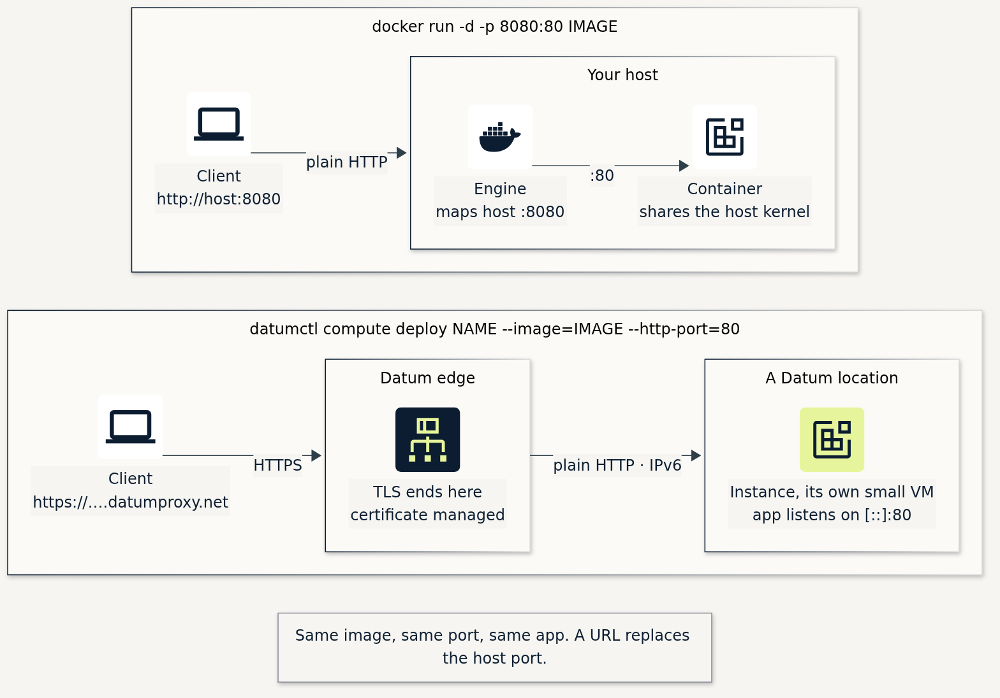
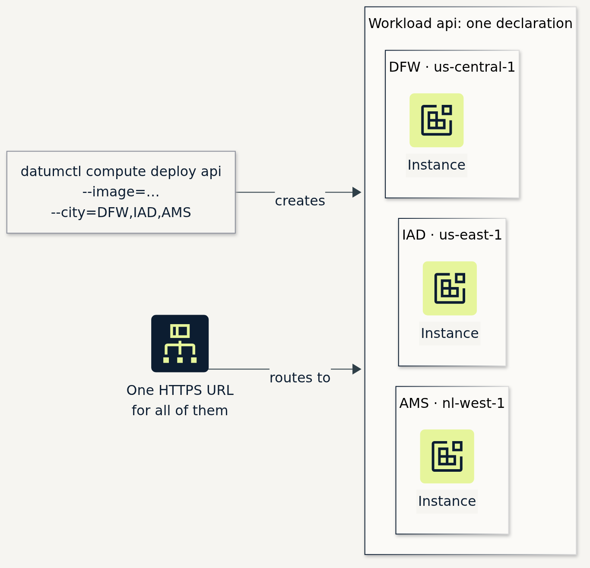
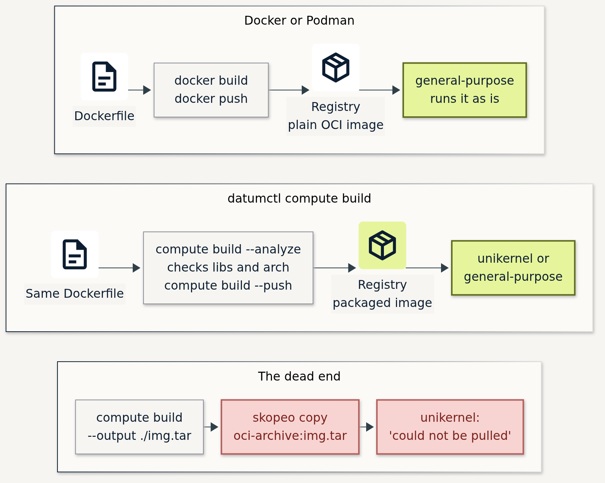
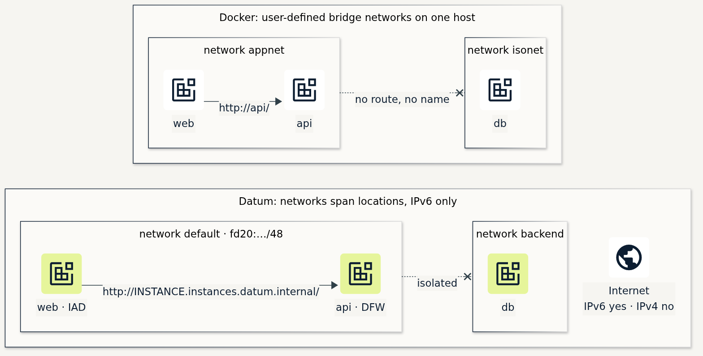

*datumctl compute · Docker 20.10 · Podman 4.3 · captured Nov 2026*

If you can run a container with `docker` or `podman`, you can run one on Datum.

## Same command

```bash
docker run -d -p 8080:80 docker.io/traefik/whoami
```

```bash
datumctl compute deploy whoami --image=docker.io/traefik/whoami \
  --http-port=80 --location=us-east-1 --runtime-class=general-purpose
```



*Same image, same port. A URL takes the place of the host port, and TLS ends at Datum's edge.*

- Pass `--runtime-class=general-purpose` for a stock image. The default is `unikernel`.
  [Why](../gists/compute/datumctl-compute-reference.md#5-runtime-classes)
- The app listens on `::`. Instances are IPv6 only.
  [More](../gists/compute/datumctl-compute-reference.md#6-ports-urls-and-protocols)

## Same verbs

| You type | Now type |
|---|---|
| `docker run` | `datumctl compute deploy` |
| `docker ps` | `datumctl compute workloads` |
| `docker logs -f` | `datumctl compute logs -f` |
| `docker exec -it … sh` | `datumctl compute exec … -it -- sh` |
| `docker restart` | `datumctl compute restart` |
| `docker rm -f` | `datumctl compute destroy` |
| `docker build` | `datumctl compute build` |
| `docker context use` | `datumctl ctx` |
| `-e`, `--env-file`, `-v` | `--env`, `--env-from-secret`, `--secret` |

[Every verb and flag](../gists/compute/datumctl-compute-reference.md#2-command-map)

## Same command, more places

```bash
datumctl compute deploy api --image=ghcr.io/acme/api:1.4.2 --city=DFW,IAD,AMS \
  --http-port=8080 --runtime-class=general-purpose
```



*One command, one Workload, one Instance in each city, one URL.*

## Same config, two speeds

| You change | Running app sees it |
|---|---|
| A Secret or ConfigMap mounted as a file | Right away |
| A Secret or ConfigMap read as env | After `datumctl compute restart` |
| `--env` | New Instances roll out |
| The image, same tag | Nothing. Use a new tag or a digest |
| `--runtime-class`, `--network`, the name | Refused. Destroy and deploy again |

[What changes what](../gists/compute/datumctl-compute-reference.md#8-what-changes-what)

## Same Dockerfile



*Any image runs on `general-purpose`. `datumctl compute build` packages it for `unikernel` too.*

```text
$ datumctl compute build --analyze .
  finding entrypoint /usr/local/bin/python3
  running architecture check ... running runtime libraries check ...
✓ No compatibility issues found
```

`--fix` and `deploy --build` edit your Dockerfile in place.
[Build details](../gists/compute/datumctl-compute-reference.md#9-build)

## Same networks, IPv6



*Names resolve inside a network, and networks stay isolated. Datum's networks span cities, and egress is IPv6 only.*

[Networks, DNS and egress](../gists/compute/datumctl-compute-reference.md#11-networks-dns-and-egress)

## Same YAML shape, a different kind

```yaml
apiVersion: compute.datumapis.com/v1alpha
kind: Workload
metadata: {name: whoami}
spec:
  template:
    spec:
      runtime:
        class: general-purpose
        sandbox:
          containers:
            - name: app
              image: docker.io/traefik/whoami
              ports: [{name: http, port: 80}]
      networkInterfaces:
        - network: {name: default}
  placements:
    - name: east
      locations: [{name: us-east-1}]
```

`podman generate kube` output doesn't convert: a Pod isn't a Workload.
[Full manifest](../gists/compute/datumctl-compute-reference.md#12-manifests)

## Run datumctl itself in a container

```bash
podman run --rm -it -v datumctl-config:/root/.datumctl docker.io/dlotterman/datumctl-container:latest login
```

[dlotterman/datumctl-container](https://github.com/dlotterman/datumctl-container)

## Before you copy this

- Compute is in preview, on a `v1alpha` API.
- A flag deploy over a manifest deploy drops `command`, `args` and pull secrets. Pick one way per workload.
- `apply` keeps a Secret's `stringData` in plain text in an annotation.
- Everything else, with transcripts and open questions: the
  [technical reference](../gists/compute/datumctl-compute-reference.md).

Compute is free during Datum's beta. If you try this and something breaks, tell us:
[get involved](https://www.datum.net/docs/get-involved).

Claude did most of the building and testing in my terminal. I read every line before I believed it.
