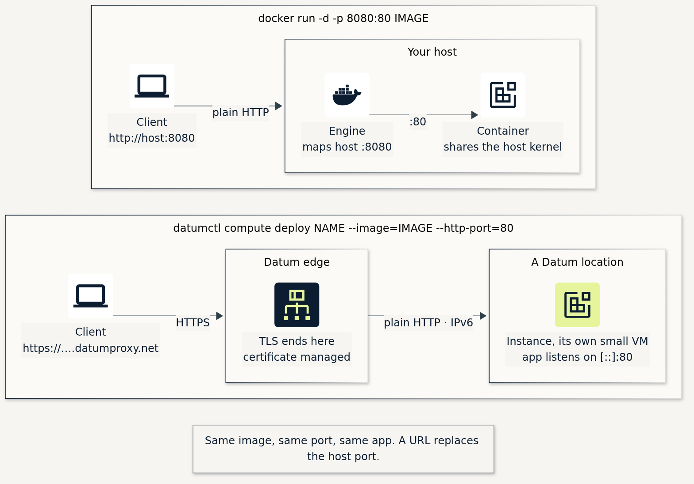
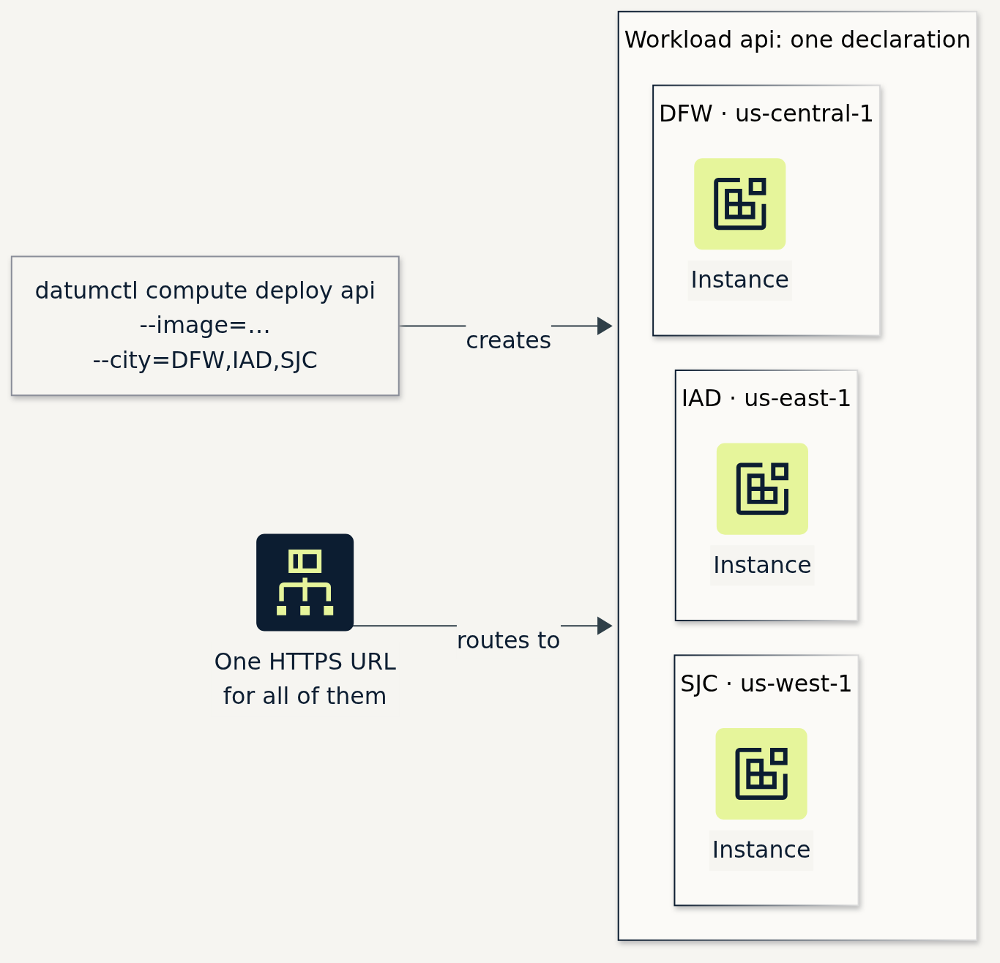
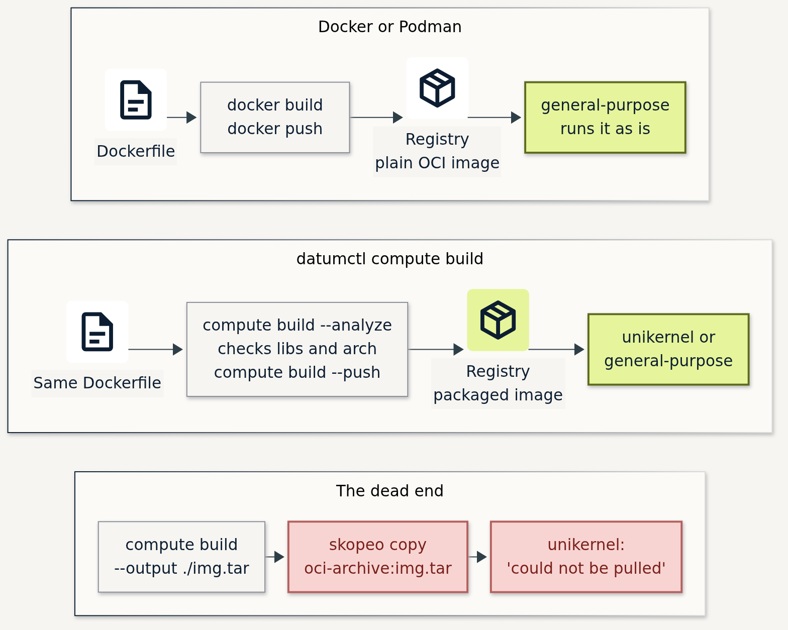
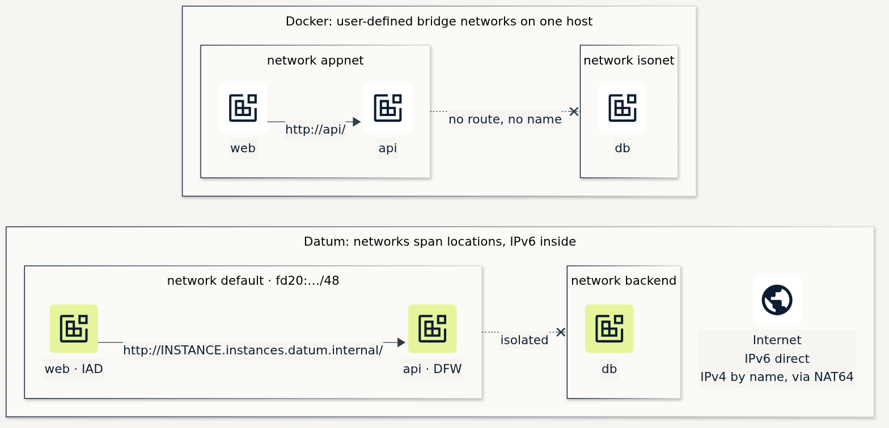

*datumctl compute plugin v0.12 · Docker 20.10 · Podman 4.3 · captured 13 Nov 2026*

If you can run a container with `docker` or `podman`, you can run one on Datum.

## Same command

```bash
docker run -d -p 8080:80 docker.io/traefik/whoami
```

```bash
datumctl compute deploy whoami --image=docker.io/traefik/whoami \
  --http-port=80 --location=us-east-1 --runtime-class=general-purpose
```



*Same image, same port. A URL takes the place of the host port, and TLS ends at Datum's edge.*


*Terminal run: the same whoami image under `docker run` and `datumctl compute deploy`. On Datum it answers on an HTTPS URL, from an IPv6 address.*

- Pass `--runtime-class=general-purpose` for a stock image. The default is `unikernel`.
  [Why](../gists/compute/datumctl-compute-reference.md#5-runtime-classes)
- The app listens on `::`. Instances are IPv6 only.
  [IPv6 crash course](https://www.datum.net/blog/ipv6-crash-course)

## Same verbs

| You type | Now type |
|---|---|
| `docker run` | `datumctl compute deploy` |
| `docker ps` | `datumctl compute workloads` |
| `docker logs -f` | `datumctl compute logs -f` |
| `docker exec -it … sh` | `datumctl compute exec … -it -- sh` |
| `docker restart` | `datumctl compute restart` |
| `docker rm -f` | `datumctl compute destroy` |
| `docker build` | `datumctl compute build` |
| `docker context use` | `datumctl ctx` |
| `-e`, `--env-file`, `-v` | `--env`, `--env-from-secret`, `--secret` |


*Terminal run: `ps`, `logs` and `exec` on both. The container reports the host's kernel. The Instance reports its own.*

[Every verb and flag](../gists/compute/datumctl-compute-reference.md#2-command-map)

## Same defaults, almost

```bash
podman run --cap-drop SYS_CHROOT --security-opt no-new-privileges IMAGE
```

*Podman's default capabilities, minus `SYS_CHROOT`, with no-new-privileges: the same set as a `general-purpose` Instance.*

[Measured sets](../gists/compute/datumctl-compute-reference.md#14-local-preflight-with-podman)

## Same command, more places

```bash
datumctl compute deploy api --image=docker.io/traefik/whoami --city=DFW,IAD,SJC \
  --http-port=80 --runtime-class=general-purpose
```



*One command, one Workload, one Instance in each city, one URL.*


*Terminal run: three cities, 8 seconds, one URL.*

Compute runs in `us-central-1` (DFW), `us-east-1` (IAD) and `us-west-1` (SJC).
[Placement](../gists/compute/datumctl-compute-reference.md#43-many-places-from-one-command)

## Same Dockerfile



*Any image runs on `general-purpose`. `datumctl compute build` packages it for `unikernel` too.*

```text
$ datumctl compute build --analyze .
  finding entrypoint /usr/local/bin/python3
  running architecture check ... running runtime libraries check ...
✓ No compatibility issues found
```

`--fix` and `deploy --build` edit your Dockerfile in place.
[Build details](../gists/compute/datumctl-compute-reference.md#9-build)

## Same(-ish) IPv6 networks



*Names resolve inside a network, and networks stay isolated. Datum's networks span cities. IPv4-only services are reachable by name, through DNS64 and NAT64.*

```yaml
# compose.yaml
services:
  api:
    image: docker.io/traefik/whoami
    networks: [backend]

networks:
  backend: {}
```

```yaml
# network.yaml + workload.yaml
apiVersion: networking.datumapis.com/v1alpha
kind: Network
metadata: {name: backend}
spec:
  ipam: {mode: Auto}
---
apiVersion: compute.datumapis.com/v1alpha
kind: Workload
metadata: {name: api}
spec:
  template:
    spec:
      networkInterfaces:
        - network: {name: backend}
      runtime: …                     # as in "Same(-ish) YAML shape" below
  placements: …
```

[Networks, DNS and egress](../gists/compute/datumctl-compute-reference.md#11-networks-dns-and-egress) ·
[IPv6 crash course](https://www.datum.net/blog/ipv6-crash-course)

## Same(-ish) YAML shape

```yaml
apiVersion: compute.datumapis.com/v1alpha
kind: Workload
metadata: {name: whoami}
spec:
  template:
    spec:
      runtime:
        class: general-purpose
        sandbox:
          containers:
            - name: app
              image: docker.io/traefik/whoami
              ports: [{name: http, port: 80}]
      networkInterfaces:
        - network: {name: default}
  placements:
    - name: east
      locations: [{name: us-east-1}]
      scaleSettings: {minReplicas: 1}
```

Workload files will look familiar to consumers of Compose and Kubeconfig files.
[Full manifest](../gists/compute/datumctl-compute-reference.md#12-manifests)

## Run datumctl itself in a container

```bash
podman run --rm -it -v datumctl-config:/root/.datumctl docker.io/dlotterman/datumctl-container:latest login
```

[dlotterman/datumctl-container](https://github.com/dlotterman/datumctl-container)
