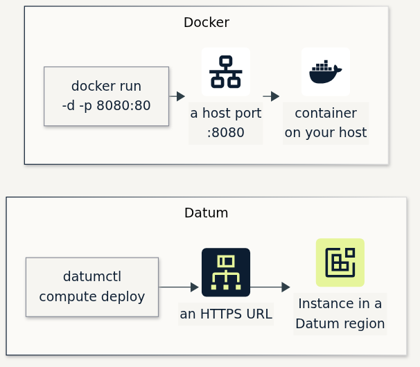
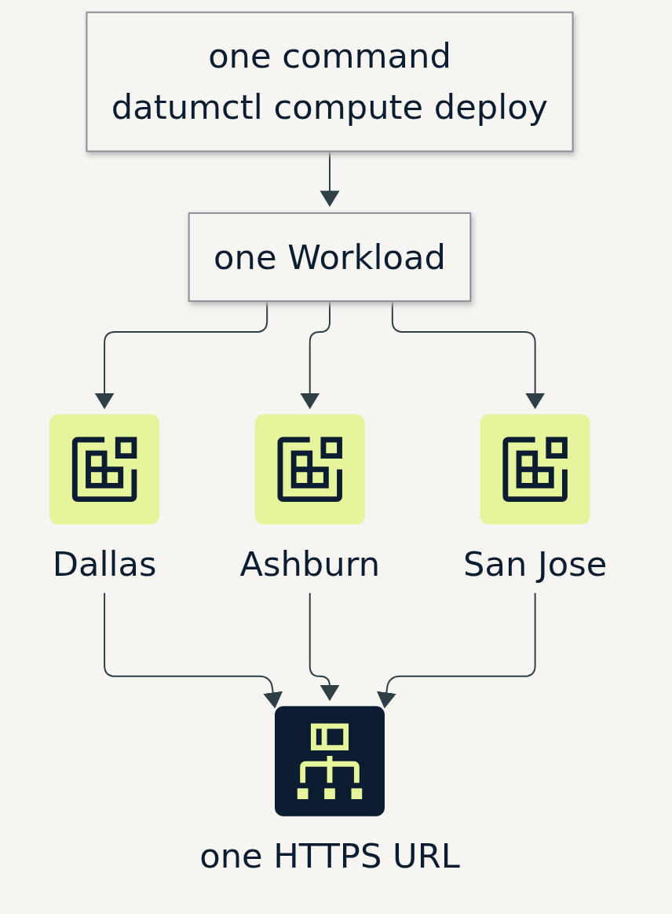
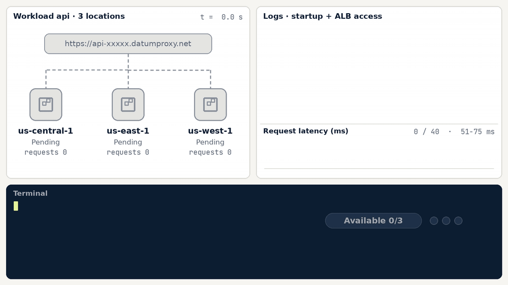
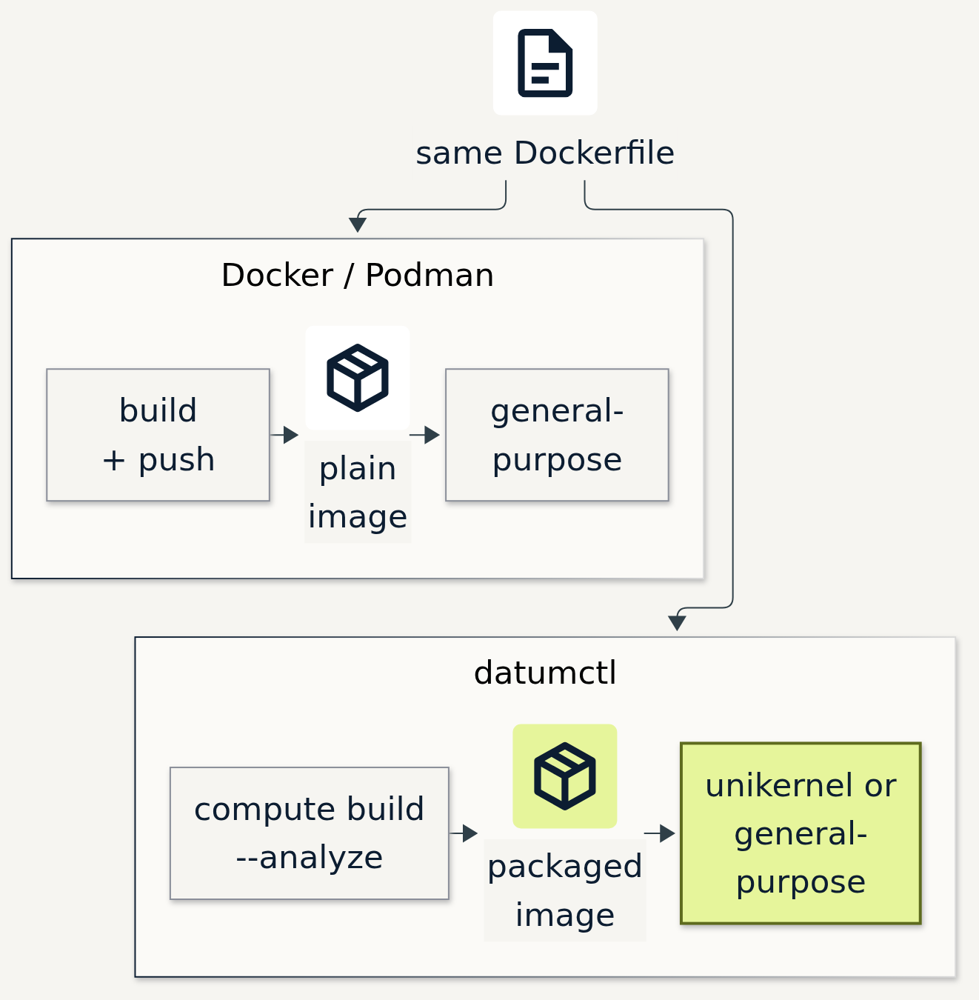
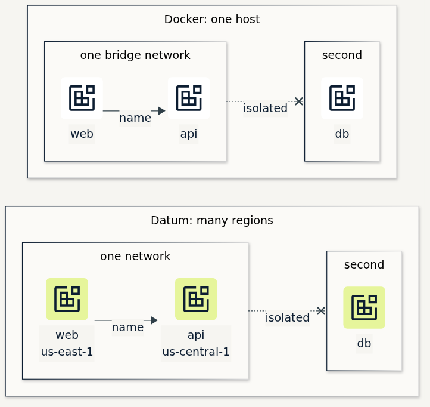

*datumctl compute plugin v0.12 · Podman 5.8 · captured 25 Nov 2026*

One image, one port, two commands.

## Same image

```bash
docker run -d -p 8080:80 docker.io/traefik/whoami
```

```bash
datumctl compute deploy whoami --image=docker.io/traefik/whoami \
  --http-port=80 --location=us-east-1 --runtime-class=general-purpose
```



*Same image, same port. A URL replaces the host port. One extra flag, because the default runtime class is `unikernel`: [why](../gists/compute/datumctl-docker-podman-reference.md#5-runtime-classes).*


*Terminal run: the same whoami image under `podman run` and `datumctl compute deploy`. On Datum it answers on an HTTPS URL, from an IPv6 address, because the app listens on `::` ([IPv6 crash course](https://www.datum.net/blog/ipv6-crash-course)). Waits trimmed.*

## Same verbs

| Docker | Datum |
|---|---|
| `docker run` | `datumctl compute deploy` |
| `docker ps` | `datumctl compute workloads` |
| `docker logs -f` | `datumctl compute logs -f` |
| `docker exec -it CONTAINER …` | `datumctl compute exec INSTANCE -it -- …` |
| `docker restart` | `datumctl compute restart` |
| `docker rm -f` | `datumctl compute destroy` |
| `docker build` | `datumctl compute build` |
| `docker context use` | `datumctl ctx` |

No `docker stop` or `docker start`. An Instance runs until you `destroy` it, and `--min` can't go below 1, so there is no scale to zero.
`compute restart` is a rolling restart, one Instance at a time per location.
[Operate](../gists/compute/datumctl-docker-podman-reference.md#13-operate-logs-exec-scale-restart-destroy)


*Terminal run: `ps`, `logs` and `exec` on both. The container reports the host's kernel. The Instance boots its own. A `general-purpose` Instance's capabilities can be matched locally: [measured sets](../gists/compute/datumctl-docker-podman-reference.md#14-local-preflight-with-podman).*

[Every verb and flag](../gists/compute/datumctl-docker-podman-reference.md#2-command-map)

## Same image, three regions

```bash
datumctl compute deploy api --image=docker.io/traefik/whoami --location=us-central-1,us-east-1,us-west-1 \
  --http-port=80 --runtime-class=general-purpose
```



*One command, one Workload, one Instance in each region, one URL.*



*Captured run: three regions, one URL. The rollout reported 6 s. The first 200 from the URL came at about 22 s. Every request was answered by us-west-1, the region nearest the client.*

Compute runs in `us-central-1`, `us-east-1` and `us-west-1`.
[Placement](../gists/compute/datumctl-docker-podman-reference.md#43-many-places-from-one-command)

## Same Dockerfile



*Any image runs on `general-purpose`. `datumctl compute build` packages it for `unikernel` too.*

```text
$ datumctl compute build --analyze .
  finding entrypoint /usr/local/bin/python3
  running architecture check ... running runtime libraries check ...
✓ No compatibility issues found
```

*`--analyze` checks. `--fix` edits your Dockerfile in place.*

[Build details](../gists/compute/datumctl-docker-podman-reference.md#9-build)

## Same(-ish) YAML



*Names resolve inside a network, networks stay apart, and on Datum a network spans regions.*

```yaml
# compose.yaml
services:
  api:
    image: docker.io/traefik/whoami
    networks: [backend]

networks:
  backend: {}
```

```yaml
# workload.yaml
apiVersion: compute.datumapis.com/v1alpha
kind: Workload
metadata: {name: api}
spec:
  template:
    spec:
      runtime:
        class: general-purpose
        sandbox:
          containers:
            - name: app
              image: docker.io/traefik/whoami
              ...
      networkInterfaces:
        - network: {name: backend}
  placements:
    - name: main
      locations: [{name: us-east-1}, {name: us-central-1}]
      ...
```

Workload files will look familiar to consumers of Compose files and Kubernetes manifests.
[Networks, DNS and egress](../gists/compute/datumctl-docker-podman-reference.md#11-networks-dns-and-egress) ·
[Full manifest](../gists/compute/datumctl-docker-podman-reference.md#12-manifests)

## Same `podman run`, for datumctl too

```bash
podman run --rm -it -v datumctl-config:/root/.datumctl docker.io/dlotterman/datumctl-container:latest login
```

[dlotterman/datumctl-container](https://github.com/dlotterman/datumctl-container)
