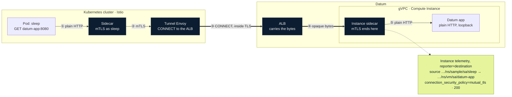
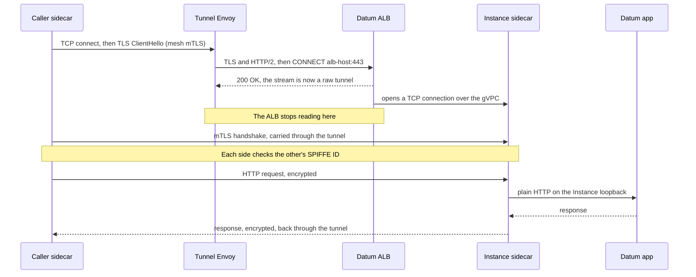

I am a big fan of [Istio](https://istio.io/) and other service meshes, I think they are the right kind of solutions for todays distributed application problems.

As I started spinning up on Datum's new [ALB](https://www.datum.net/docs/alb/overview) & [Compute](https://www.datum.net/blog/network-vs-compute) offering, it became immediately clear to me that Istio and Datum have a lot in common, and not just that, but synergies from their shared inspirations that drive really cool integration use cases.

This `short` is about the shared language, primitives and intent between Istio and Datum, through the applied usage of Datum ALB and Compute being used as "Bridges" into existing GCP k8s clusters already configured with inter-cluster Istio service meshes.



*One request from a pod in the cluster to an app on a Datum Instance*

## The same engine

Istio's data plane is [Envoy](https://www.envoyproxy.io/). So is Datum's ALB. That sounds like trivia until you try to connect
the two, and then it's most of the reason it works: when a mesh workload needs to reach something behind the ALB, it's one
Envoy talking to another, using features both already have.

It also means the ALB speaks the dialect your mesh already understands. It stamps the standard Envoy headers
(`x-request-id`, `x-forwarded-for`) on what it forwards, and the knobs it exposes are Envoy's knobs.

## The same language

Both sides describe traffic with the Kubernetes [Gateway API](https://gateway-api.sigs.k8s.io/). Istio supports it natively.
On Datum you write an `HTTPProxy`, and the platform turns it into a `Gateway` and `HTTPRoute` underneath, served by Envoy
Gateway. Behavior is changed the Gateway API way too: you attach a policy to a gateway with `targetRefs`.

That shared vocabulary paid off directly. Out of the box, the ALB answered `CONNECT` (the request that asks a proxy to open a
raw pipe) with a 404, not because it was blocked but because no route was set up for it. The fix was one policy, attached to
the workload's gateway, in a shape anyone who has attached policy to an Istio gateway will recognize:

```yaml
kind: BackendTrafficPolicy
spec:
  targetRefs:
    - {group: gateway.networking.k8s.io, kind: Gateway, name: istio-vm}
  httpUpgrade:
    - {type: websocket}
    - type: CONNECT
      connect: {terminate: true}
```

## The same primitives

The two speak the same protocols, and split the work on them in a way that fits together:

| Primitive | Datum ALB | Istio | Together |
|---|---|---|---|
| HTTP/1.1, HTTP/2, HTTP/3 | The public front door, routing by host and path | Routing, retries and splits between services | One request, the same semantics end to end |
| TLS | Ends it at the edge, with certificates it issues and renews itself | Originates and terminates it at gateways | Nobody hand-manages certificates anywhere on the path |
| mTLS and [SPIFFE](https://spiffe.io/) | Carries it untouched through a tunnel | Gives every workload a provable name and checks it on every connection | Identity survives a network neither end has to trust |
| gRPC | Supported, HTTP/2 to the origin | Balanced per call, not per connection | A protocol both were built for |
| WebSockets and `CONNECT` | Upgrades by default; `CONNECT` with one policy | Envoy tunnels TCP over `CONNECT` | How mesh traffic crosses an HTTP edge |

## The same intent

Under the protocols, the two want the same things. Both are open source and built to run wherever you need them, not inside one
provider's walls. Both assume the network in between can't be trusted: the ALB authenticates the internet at the edge, and
Istio authenticates every workload to every other. And both are built for fleets spread across many places, which is exactly
the gap a bridge between them fills.

## The bridge, in practice

To check that the harmony is real and not just a nice table, I bridged a Datum Compute workload into a multi-cluster Istio mesh
running on Google Cloud, in both directions.

**Into the mesh.** The Datum workload runs Istio's stock proxy image, with Istio's standard bootstrap files in a Datum Secret
and a short entry script in a ConfigMap. It registered itself with istiod, got its SPIFFE identity, and its calls were
load-balanced across both clusters.

**Back out of the mesh, through the ALB.** A stock Envoy in the cluster tunnels connections through the ALB with `CONNECT`,
and the pod's sidecar does mutual TLS straight through it to the sidecar on the Datum Instance. Here's what the Datum side
logged:

```text
source_principal            spiffe://cluster.local/ns/sample/sa/sleep
destination_principal       spiffe://cluster.local/ns/vm/sa/datum-app
connection_security_policy  mutual_tls
```

Both ends knew exactly who the other was, and the ALB in the middle never saw a byte of what they said.



*The CONNECT handshake, then mutual TLS through it*

It holds up: 6 to 7 ms per call from Virginia to the Instances in Ashburn once warm, and 75 answers to 75 calls while I
restarted both Instances, because the ALB follows the workload, not an address. The manifests, commands and raw output are in
the [technical reference](../gists/k8s/istio-compute-bridge-reference.md).

## What you get

- A Datum workload your mesh policies can name, reaching your services with the mesh's retries and failover.
- Mesh services calling Datum workloads with their identity intact, through an edge that never has to be trusted with the
  payload.
- No custom images and no new control plane: stock Istio, stock Envoy, a Secret, a ConfigMap and one policy.

That's useful when part of an application wants to run near users (an API front end, an agent, an inference step) while its
backends stay in your clusters.

## Before you copy this

- The `CONNECT` policy isn't documented as supported yet, and a tunnel hostname serves only tunnels, so the public front door
  needs its own.
- Keep the address family consistent: Datum Instances are IPv6-only, and IPv6 east-west gateways need no workarounds.
- gRPC, Server-Sent Events and Istio's ambient mode are untested here. The
  [reference](../gists/k8s/istio-compute-bridge-reference.md#12-limits-and-open-questions) has the full list.

Compute is free during Datum's beta. If you run a mesh and try this, tell us what broke:
[get involved](https://www.datum.net/docs/get-involved).

Claude did most of the building and testing in my terminal. I read every line before I believed it.

[[TODO: closing line, something dry and unrelated, in the spirit of the bearblog flower.]]
