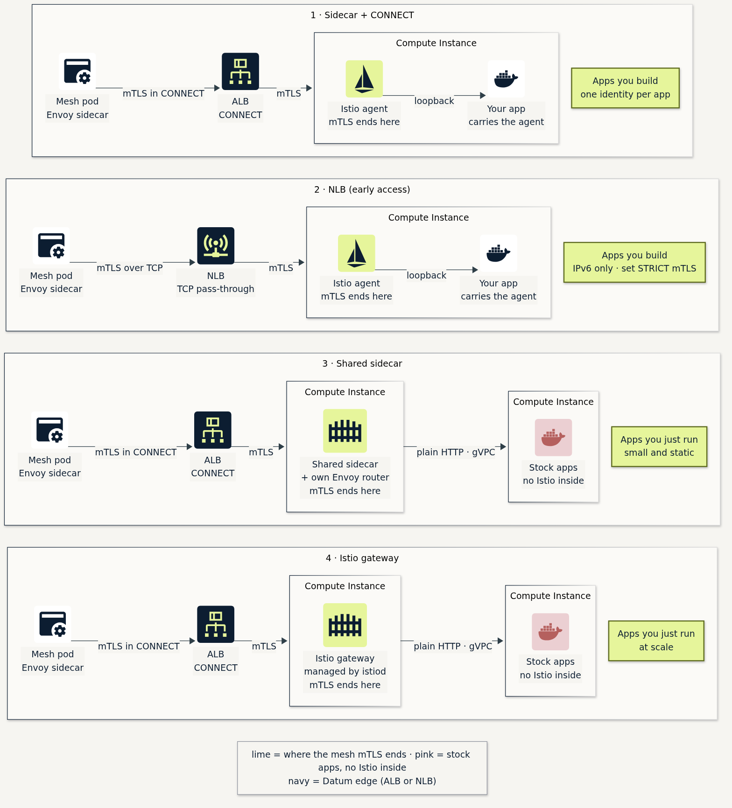
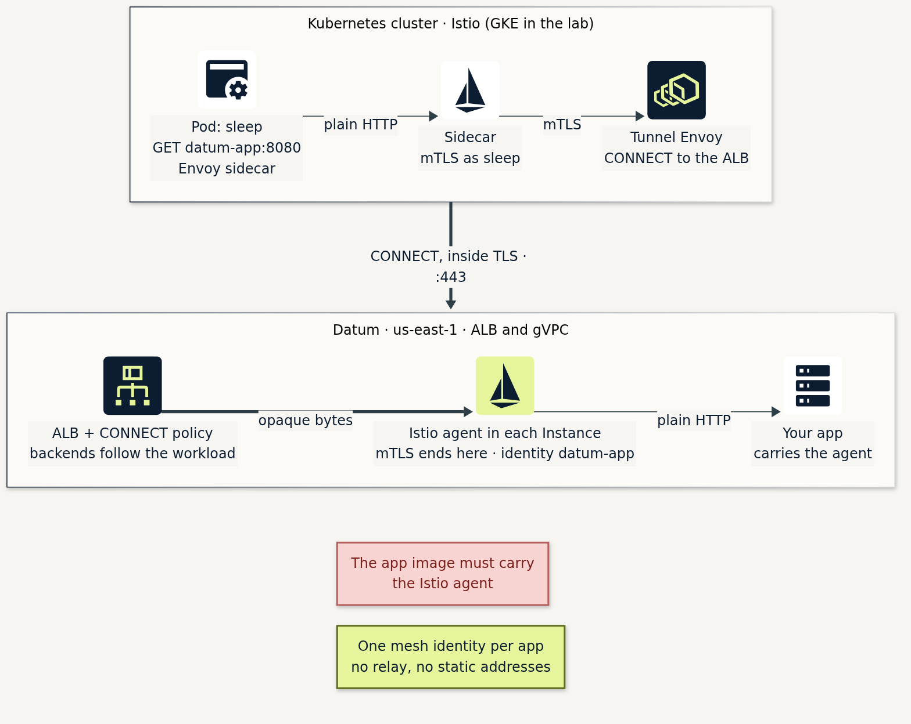
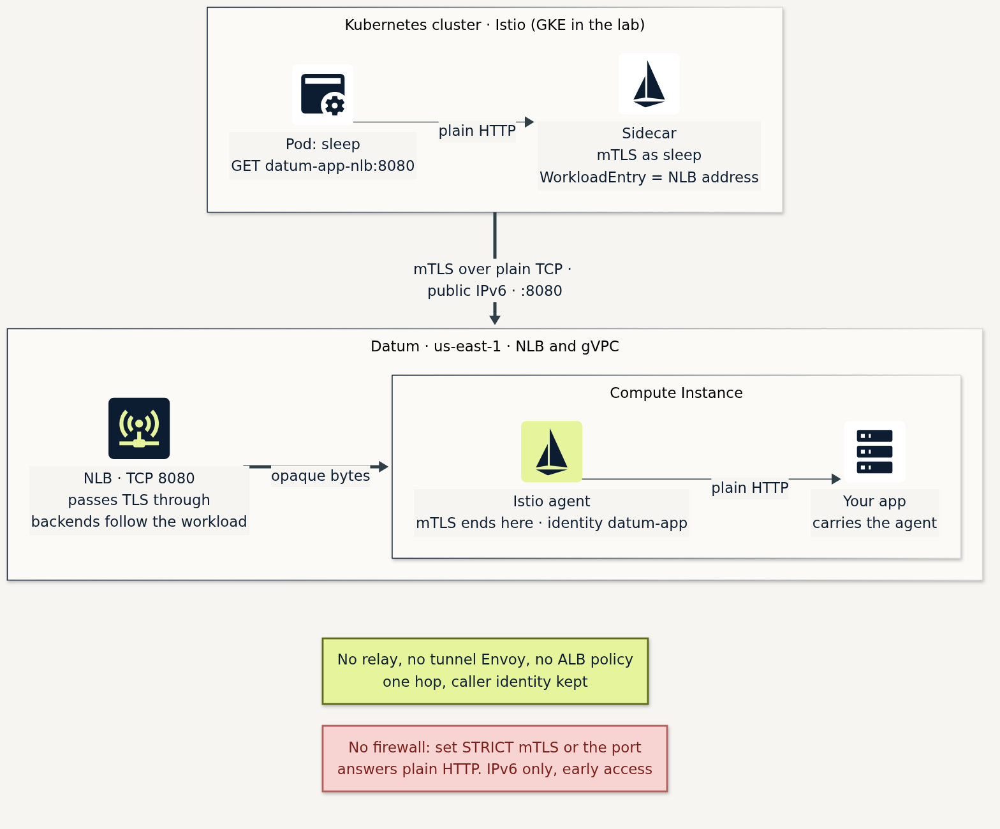
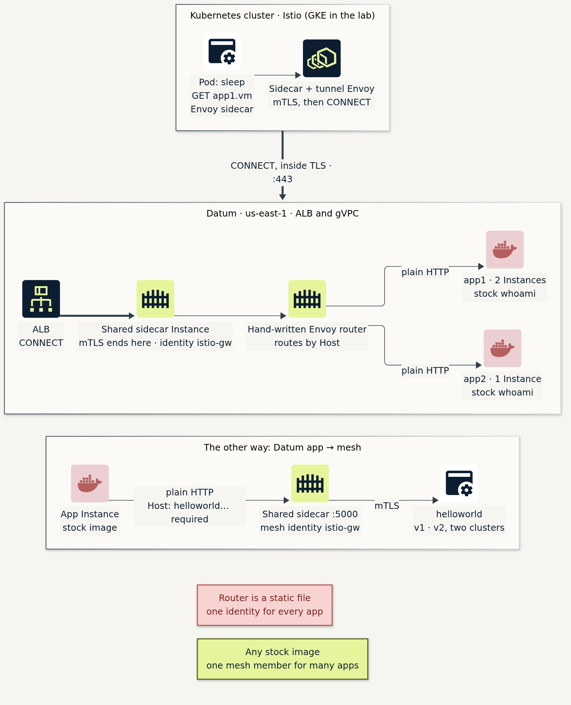
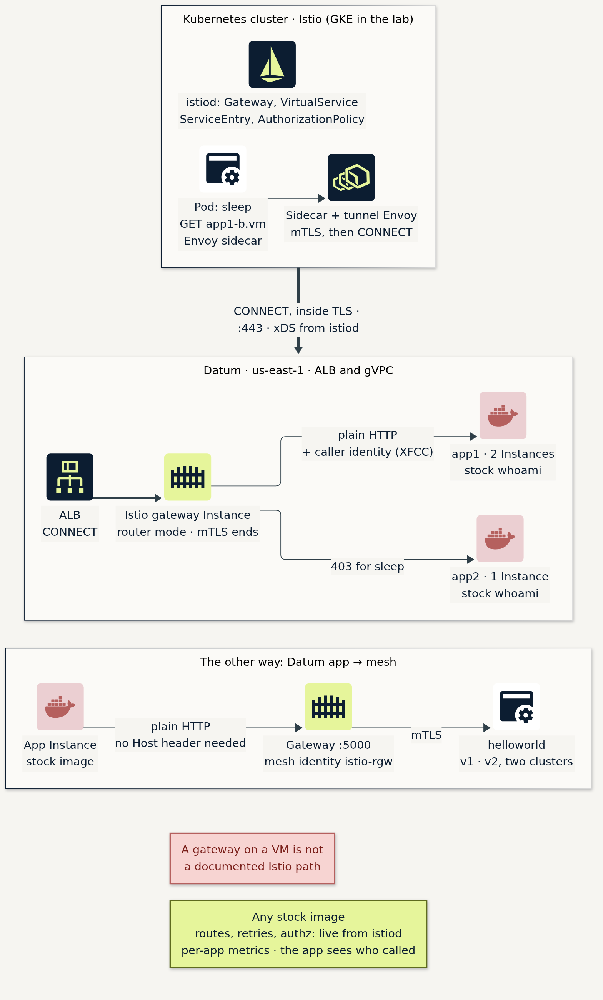

*Datum Compute · Istio 1.31.3 · captured 9–10 Nov 2026 · NLB run 10 Nov*

4 ways to bridge Istio service meshes into Datum

*Lime marks where the mesh's mTLS ends, pink the stock apps with no Istio inside.*

## Way 1: Sidecar + CONNECT

An Istio agent runs in every app Instance. A tunnel Envoy in the cluster sends HTTP `CONNECT` through the ALB with one
`BackendTrafficPolicy`. There is no relay, and the ALB backends follow the workload.

**Fits:** apps you build.

*A pod in the cluster calls the app. Its sidecar sends mTLS to a tunnel Envoy, which carries it through the ALB inside an HTTP `CONNECT`. The Istio agent in the Compute Instance ends the mTLS and hands plain HTTP to the app on loopback.*

*Terminal run, 33 s: Instances auto-register as WorkloadEntries, calls spread over both, the Instance sees `sleep → datum-app` over `mutual_tls`.*

## Way 2: NLB, straight to the sidecar

Datum's new Network Load Balancer publishes a public IPv6 address on a TCP port and passes the bytes through unchanged. The
mesh sidecar's mTLS runs straight through it to the sidecar in the app Instance. A `WorkloadEntry` whose address is the NLB's
address is the only thing the cluster needs. There is no relay, no tunnel Envoy and no ALB policy.

**Fits:** apps you build, once the NLB is out of early access. It is IPv6 only and has no failover between locations.

*The sidecar's mTLS goes to the NLB's public IPv6 address and passes through it untouched. The Istio agent in the Compute Instance ends it and hands plain HTTP to the app.*

- **Identity kept.** The Instance sees `spiffe://…/ns/sample/sa/sleep → …/ns/vm/sa/datum-app` over `mutual_tls`. Both
  Instances answer.
- **Set STRICT mTLS.** The NLB has no firewall, and with Istio's default permissive mode the public port answered plain HTTP.
  With `PeerAuthentication` set to STRICT, plain HTTP is reset and mesh calls still return 200.

## Way 3: Shared sidecar

One workload joins the mesh with an Istio sidecar and a hand-written Envoy router in the same container. Stock app images sit
behind it on the gVPC. mTLS ends at the sidecar and the last hop is plain HTTP.

**Fits:** apps you just run, small and static. The router config is a static file, so a change means a restart.

*Calls arrive through the ALB at the shared sidecar, and its own Envoy router picks app1 or app2 by `Host` header and sends plain HTTP over the gVPC. In the other direction, a Datum app calls the shared sidecar on :5000 and has to send a `Host` header.*

*Terminal run, 40 s: stock whoami apps, `RemoteAddr` is the shared sidecar, and the reverse path works only with the Host header.*

## Way 4: Istio gateway on Datum

The gateway Instance runs `pilot-agent` in router mode. istiod programs it from `Gateway`, `VirtualService`, `ServiceEntry`
and `AuthorizationPolicy`. The app sees the caller's identity in `X-Forwarded-Client-Cert`.

**Fits:** apps you just run, at scale. A gateway on a VM `WorkloadEntry` isn't a documented Istio path, and it worked first
try.

*istiod programs the gateway Instance from `Gateway`, `VirtualService`, `ServiceEntry` and `AuthorizationPolicy` objects. The mTLS ends at the gateway, which passes plain HTTP to the app with the caller's identity in a header: app1 is allowed and app2 gets a 403. In the other direction, a Datum app calls the gateway on :5000 and reaches `helloworld`, with no `Host` header needed.*

*Terminal run, 36 s: istiod objects, the app sees `URI=spiffe://…/sleep`, app1-b returns 200, app2-b returns 403, and the reverse
path needs no header.*

## What's different, and what each is worth

|  | 1 · Sidecar + CONNECT | 2 · NLB | 3 · Shared sidecar | 4 · Istio gateway |
|---|---|---|---|---|
| App image | Must carry the Istio agent | Must carry the Istio agent | Any stock image | Any stock image |
| Mesh identity | One per app | One per app | One for the shared sidecar | One for the gateway |
| Where mTLS ends | In the app Instance | In the app Instance | At the shared sidecar, then plain HTTP on the gVPC | At the gateway, then plain HTTP on the gVPC |
| Caller identity visible | At the app's own sidecar | At the app's own sidecar | Only at the shared sidecar | At the app, in `X-Forwarded-Client-Cert` |
| Per-app access control | Per app identity | Per app identity | At the shared sidecar, keyed on Host (200/403) | At the gateway, istiod-managed (200/403) |
| Per-app mesh metrics | Yes | Yes | No, both apps show as `istio-gw` | Yes |
| Datum app → mesh | Its own sidecar on loopback | Not tested | Shared sidecar :5000, and the app must send a `Host` header (503 without) | Gateway :5000, no Host header |
| Extra moving parts | Tunnel Envoy pod; one ALB policy | NLB and network service. STRICT mTLS must be set | Workload; tunnel; static router config | Gateway workload; tunnel; live config through istiod |
| Documented path? | Yes | NLB docs not merged yet (early access) | Yes (Istio `Sidecar` API) | No, but it worked |
| Fits | **Apps you build** | Apps you build, after early access | Apps you run, small and static | **Apps you run, at scale** |

## Reference Lab Architecture

